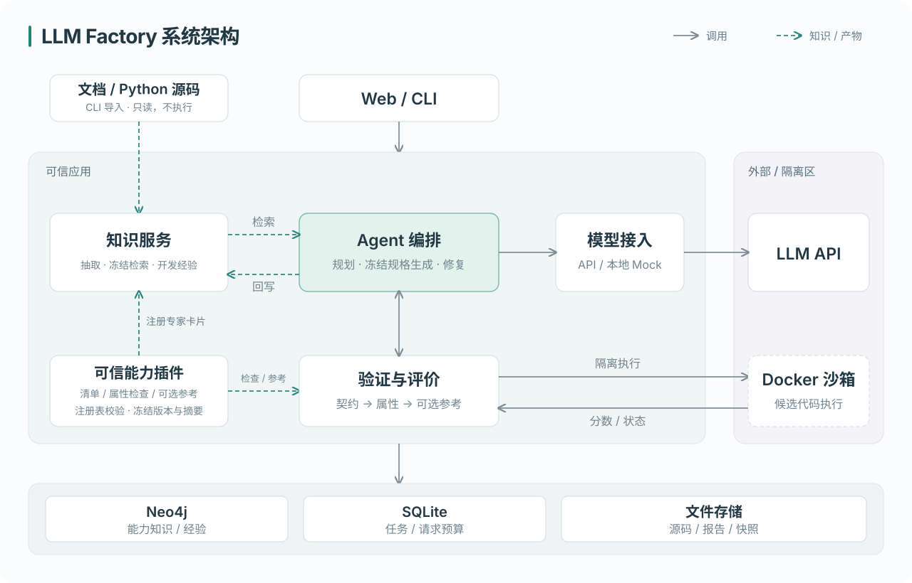
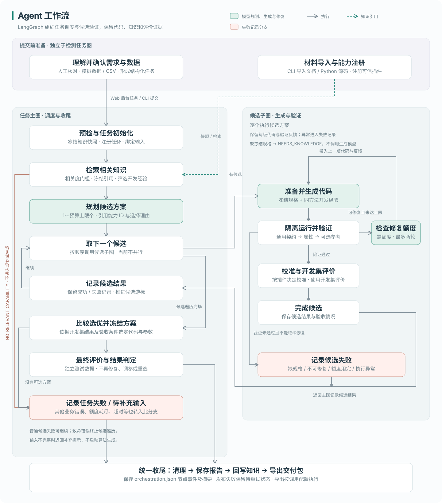

# LLM Factory：AI Agent 算法能力工厂

## 1. 项目背景和目标

**项目背景：** 在服务器运维监控场景中，CPU 利用率突增、内存持续升高、磁盘延迟波动等问题需要不同的异常检测策略。面对具体需求，开发者需要选择合适的算法、调整参数和告警条件、编写检测代码，并验证实现是否正确、检测效果是否满足要求。

这一过程存在三个问题：一是算法说明、参考代码和适用经验分散在不同材料中，查找和复用需要人工整理；二是需求变化后，代码适配、测试和方案比较需要反复进行；三是实现过程中的失败原因、修复方法和验证结果缺少统一记录，后续任务难以直接利用已有经验。因此，需要将需求理解、知识复用、代码生成和自动验证串联起来，并保留每次开发的结果与依据。

**项目目标：** 构建一个基于 AI Agent 的算法能力工厂原型，将用户的自然语言检测需求转化为可运行、可验证、可追溯的算法实现，减少重复的知识整理、代码适配和验证工作。具体包括：

1. **支持算法知识复用：** 从文档和参考代码中抽取算法规格、适用条件与接口约束，形成带来源引用的能力知识，供需求分析、方案规划和代码生成使用。
2. **支持检测算法自动实现与验证：** 根据需求生成候选代码，自动检查接口规范、功能正确性和检测效果，根据失败反馈进行有限修复，并比较候选方案，输出源码、验证报告和交付包。
3. **支持开发经验持续积累：** 将实现版本、验证结果和具体修复经验关联保存，供后续任务检索与引用，使每次开发的结果能够成为下一次任务的参考。

**本期范围：** 以服务器监控中的单主机、单数值指标异常检测为验证场景，CPU 利用率、内存使用率、磁盘延迟等指标采用模拟采集数据。支持固定阈值、滚动 MAD 和 EWMA，验证“能力抽取—算法复刻—自动验证—知识沉淀”的端到端流程。

## 2. 系统架构和模块设计



Web 与 CLI 共用服务入口；知识库保存能力与经验，任务账本记录状态和请求额度，文件保存源码、冻结快照及报告。

| 模块 | 作用 |
| --- | --- |
| 交互与服务 | 提交需求、启动任务、查看与导出结果 |
| 能力与知识 | 注册算法能力、抽取材料、校验引用并冻结检索结果 |
| Agent 编排 | 控制代码生成、验证、有限修复和候选选优 |
| 执行与评价 | 在沙箱中执行代码，检查接口与算法逻辑，评价检测效果 |
| 报告与沉淀 | 关联源码与验证记录，生成报告并将结果和经验回写知识库 |

主要目录与入口如下，省略部分文件：

```text
.
├── streamlit_app.py          # Web 启动入口
├── src/
│   ├── factory/
│   │   ├── cli.py           # 统一 CLI 入口
│   │   ├── metrics/         # 需求理解、知识检索、代码生成、评价及 Web 页面
│   │   │   └── orchestration/  # LangGraph 任务主图与候选子图
│   │   ├── models/          # 模型客户端、配置与请求传输
│   │   └── runtime/         # 运行配置、任务存储、锁及产物管理
│   ├── contracts/           # 执行与数据契约
│   └── execution/           # 生成代码的隔离执行与校验
├── capabilities/            # 固定阈值、滚动 MAD、EWMA 的能力卡片与插件
├── materials/               # 知识抽取使用的算法文档与参考代码
├── configs/                 # 指标任务与模型配置
├── tests/                   # 指标流程、模型接入及基础设施测试
├── scripts/                 # 环境准备、验收、图谱导出与代码检查脚本
├── deploy/                  # 服务安装脚本、systemd 模板及 Neo4j 配置
├── case-example/metrics/    # 示例任务、生成源码、验证报告与证据附件
├── examples/                # 使用示例
├── docs/                    # 运行指南、架构图及文档资源
├── .github/workflows/       # CI 工作流
├── Dockerfile.sandbox       # 检测器执行沙箱镜像
├── docker-compose.yml      # 容器服务配置
├── pyproject.toml           # Python 包配置与工具设置
└── requirements*.txt        # 依赖入口与锁定版本
```

**技术选型：** Streamlit 提供轻量交互；LangGraph 显式表达条件分支与有限修复；Neo4j 表达材料、能力、实现和经验的关联；SQLite 保存任务及请求预算；Docker 隔离执行生成代码。算法采用 Python 标准库，降低依赖与复现成本。无密钥演示可使用本地 SQLite 知识后端，默认 Web 使用 Neo4j。

## 3. 能力知识图谱 schema 和示例

知识图谱同时保存“算法如何实现”和“某次实现验证得怎样”。以实际注册的[固定阈值能力卡片](capabilities/fixed_threshold/capability.json)为例：

| 信息 | 示例内容 |
| --- | --- |
| 能力与版本 | `fixed_threshold`，版本 `1.1.0` |
| 输入 / 输出 | 输入 `timestamp, host_id, value`；输出 `timestamp, host_id, status, score, evidence` |
| 适用条件 | 单主机、单指标 gauge/rate；支持上界或下界检测，无需历史基线；业务阈值须有明确依据 |
| 算法规格 | 上界分数为 `x − T`，下界为 `T − x`；严格大于零才构成异常候选 |
| 评价与依赖 | 事件/点级 F1、正常误报频次、发现延迟；Python 3.12 标准库环境 |
| 原始依据 | [固定阈值说明](materials/metrics/02-fixed-threshold.txt)第 3～7 行及参考代码，保存逐字引用、行号与文件摘要 |
| 历史验证 | 经实现节点关联各版源码、检查结果和检测指标，验证等级属于具体实现 |

主要关系如下：

```text
Capability ─DERIVED_FROM→ Chunk ─DERIVED_FROM→ Source
Capability ─IMPLEMENTED_BY→ Implementation ─EVALUATED_BY→ ValidationRun
Experience ─LEARNED_FROM→ ValidationRun
Capability（新版）─SUPERSEDES→ Capability（旧版）
```

模型抽取结果、专家注册卡片和运行产生的验证/经验记录分别保留来源；专家卡片标记 `reference`，真实模型产物标记 `llm_api`，Mock 单独标记。材料引用可追溯不代表实现已通过验证。

生成使用冻结知识，记录能力版本和规格摘要；后续任务可检索已沉淀的开发反馈。模型抽取示例见[真实抽取快照](case-example/metrics/delivery/knowledge-source.json)。

## 4. Agent 工作流设计



- **任务主图：** 根据确认后的需求检索知识、规划候选，调用候选子图完成各方案的生成与验证，再选优并冻结方案，执行最终测试，输出报告与交付包，将验证结果和开发经验回写知识库。
- **候选子图：** 负责单个候选的代码生成、Docker 隔离验证与有限修复；验证通过后进行阈值校准和开发集评价，将结果交回主图比较。

## 5. 环境配置和运行方法

**入口一：Web 与真实模型（推荐）。** 在 Linux 服务器上准备 Python 3.12、Docker、Neo4j 和模型 API 配置，通过 Web 完成需求理解、代码生成、验证及交付包下载。API 调用消耗额度并可能产生费用，凭据保存在仓库外。环境安装、配置、启动和页面操作见 [Web 真实模型运行指南](docs/getting-started.md)。

**入口二：无密钥演示。** 使用本地 SQLite 知识库和 Mock 响应，无需 Neo4j 或 API Key，也可体验材料导入、沙箱验证与回写。Mock 复制人工参考实现，仅用于流程验证；安装、运行和结果查看见[无密钥演示运行指南](docs/no-key-demo.md)。

## 6. 示例数据和测试任务说明

内置六个模拟场景涵盖突增、阶跃、漂移、业务高峰、缺失和周期波动。本节选取 CPU、内存和磁盘三个案例，并补充一个受控故障修复任务，说明输入数据、任务参数及验证目的，对应结果见第 8 节。

| 验证目的 | 示例场景 | 需求与关键参数 |
| --- | --- | --- |
| 单方法生成与验证 | CPU 突升 | 超过 90%，连续 3 点，仅固定阈值 |
| 多候选比较与选优 | 内存漂移 | 固定阈值 70%、MAD、EWMA α=0.2；连续 2 点，优先覆盖持续异常 |
| 经验沉淀与后续引用 | 磁盘延迟 | EWMA α=0.3 与 MAD；连续 2 点，尽量减少误报 |
| 失败修复与版本追溯 | 内存阶跃（受控注入） | 固定阈值 85%、连续 2 点；真实模型按属性失败反馈修复 |

每个模拟任务均划分为 train、calibration、development、test：训练段拟合基线，校准段无标签确定阈值，开发段比较候选，冻结后仅对胜出者进行最终测试。各角色独立初始化，最终测试数据与标签不进入模型上下文。默认每段有 60 点暖机和 240 个计分点，采样间隔为 60 秒；标签由模拟器预先定义的异常区间独立生成，不从候选预测反推。验证结果及对应报告见[第 8 节](#8-验证结果和报告样例)。

CSV 包含 UTC `timestamp,host_id,value`，支持 202～50,000 点、最大 16 MiB，可另附标签。无标签时不展示准确率或漏检率。

以下为构造的 CPU 百分比数据格式示意，完整上传数据需满足上述点数要求：

```csv
timestamp,host_id,value
2026-11-02T00:00:00Z,demo-host-1,88.0
2026-11-02T00:01:00Z,demo-host-1,91.0
2026-11-02T00:02:00Z,demo-host-1,93.0
2026-11-02T00:03:00Z,demo-host-1,92.0
```

以下按表中顺序展示各任务的生成源码与关键逻辑。

## 7. 生成算法代码示例

以下源码与第 8 节四个实验一一对应，均保留任务 ID、候选版本及验证记录。代码片段省略外围逻辑，完整实现见各案例链接。

### 7.1 CPU：固定阈值检测器

任务 `ui-3dea5cbfa50d4154` 生成候选 `fixed_upper_cpu_90_p3`，v0 的核心评分逻辑如下：

```python
value = float(value)
if self.direction == "upper":
    score = value - self.threshold
else:
    score = self.threshold - value
```

冻结配置为 `threshold=90.0,direction=upper`，框架在分数严格大于零且连续满足 3 点后告警，等于 90 不触发。完整实现还处理缺失、无效输入及状态保存恢复。

实际源码：[固定阈值 v0 源码](case-example/metrics/web-verification-20261102/final-classics-20261103/runs/cpu/candidate-dc9b2f18f5619ee06db95e9689a3ef12f9c98a6ad2c153263b16bb37da87f460/v0.py)。工程检查与检测结果见[CPU 验证报告](case-example/metrics/web-verification-20261102/cpu-report.md)。

### 7.2 内存：三候选与 EWMA 实现

任务 `ui-1deabf9ab9634a9a` 从同一需求生成三个候选：

| 候选 | 关键参数与逻辑 | 实际源码 |
| --- | --- | --- |
| `fixed_threshold_memory_upper_70` | 上界阈值 70，计算当前值与阈值之差 | [固定阈值 v0 源码](case-example/metrics/web-verification-20261102/final-classics-20261103/runs/memory/candidate-ee488d83f2be3a63c3bf1b4ce55e059b9a5f8166e910926b4f1717917536c02e/v0.py) |
| `rolling_mad_memory_upper_default` | 窗口 30，至少 15 个原始有效点，按历史中位数与 MAD 评分 | [滚动 MAD v0 源码](case-example/metrics/web-verification-20261102/final-classics-20261103/runs/memory/candidate-cce35994780269d48115a68b57f08e142bb2bb94d94e289ae7536fb379c7e076/v0.py) |
| `ewma_memory_upper_alpha02` | α=0.2，至少 3 个原始有效点，以训练基线标准化平滑值 | [EWMA v0 源码](case-example/metrics/web-verification-20261102/final-classics-20261103/runs/memory/candidate-f8e383a9e6e045eb20e3da125d037cf5987c71070e859b91b3e79a8c2003974e/v0.py) |

EWMA 在训练段计算固定均值与总体标准差，将平滑状态初始化为训练均值。核心更新与标准化公式为：

```python
self.smooth = alpha * x + (1.0 - alpha) * self.smooth
```

```python
normalized = (self.smooth - self.baseline) / self.scale
```

只有 `original_present` 为 true 的有效点才计入冷启动计数，不足 3 点时返回 `insufficient_history`。三种方法均执行连续 2 点告警；MAD 与 EWMA 的分数阈值通过无标签校准确定。按持续区间覆盖目标、balanced 策略选中 EWMA，结果见[内存验证报告](case-example/metrics/web-verification-20261102/memory-report.md)。

### 7.3 磁盘：EWMA 与 MAD 实现

任务 `ui-1a5c876ccd124f53` 生成 [EWMA v0 源码](case-example/metrics/web-verification-20261102/final-classics-20261103/runs/disk/candidate-4e5d989937b55224b97743f8b09a349fda30852848a985bc48edabf7db76c7d0/v0.py)（`ewma_alpha0.3_p2_upper`，α=0.3）与 [滚动 MAD v0 源码](case-example/metrics/web-verification-20261102/final-classics-20261103/runs/disk/candidate-a05bcd28138e5ad3e95465fd66a1f2ae84d272980209d06507da6ea1b4f2c1ec/v0.py)（`rolling_mad_w30_p2_upper`，窗口 30、至少 15 个原始有效点），统一执行连续 2 点告警。

EWMA 平滑当前值，MAD 使用当前点之前的历史窗口评分；两份实现均提供状态保存与恢复接口。本次生成引用了内存任务沉淀的两条经验，候选比较与引用证据见[磁盘验证报告](case-example/metrics/web-verification-20261102/disk-report.md)。

### 7.4 内存阶跃：受控故障修复

任务 `ui-5f4299d229da4349` 的固定阈值候选 `fixed_threshold_upper_85_p2` 保留 [固定阈值 v0 源码](case-example/metrics/web-verification-20261102/final-classics-20261103/runs/repair/candidate-7e28edc5e837ce161ffe7d64866aa375ca7913b2249e6f7f02ed1e4a7b302edb/v0.py) 与 [固定阈值 v1 源码](case-example/metrics/web-verification-20261102/final-classics-20261103/runs/repair/candidate-7e28edc5e837ce161ffe7d64866aa375ca7913b2249e6f7f02ed1e4a7b302edb/v1.py)。v0 在真实模型原稿外加入测试代理，对有效输出额外加分：

```python
if result['status'] == 'ok': result['score'] += 1.0
```

该注入使阈值边界属性检查失败；真实模型根据失败源码和开发反馈生成 v1，移除错误加分并通过复验。父版本、检查结果及最终效果见[受控修复报告](case-example/metrics/web-verification-20261102/history-repair-report.md)。该案例不计自然错误修复率。

## 8. 验证结果和报告样例

| 验证目的 | 示例场景 | 验证结果 |
| --- | --- | --- |
| 单方法生成与验证 | CPU 突升 | [固定阈值 v0 通过；点 F1 0.6154，事件 F1 0.8000](case-example/metrics/web-verification-20261102/cpu-report.md) |
| 多候选比较与选优 | 内存漂移 | [3 个候选通过，选择 EWMA；点 Recall 0.9545、F1 0.9130](case-example/metrics/web-verification-20261102/memory-report.md) |
| 经验沉淀与后续引用 | 磁盘延迟 | [内存 MAD/EWMA 两条经验被提供并引用；点 F1 0.3333，事件 F1 1.0000](case-example/metrics/web-verification-20261102/disk-report.md) |
| 失败修复与版本追溯 | 内存阶跃（受控注入） | [v0 属性失败、真实模型 v1 修复通过；点 F1 0.9916](case-example/metrics/web-verification-20261102/history-repair-report.md) |

[完整验证报告与证据](case-example/metrics/web-verification-20261102/REPORT.md)。

## 9. 遇到的挑战和解决方案

### 9.1 模型抽取的知识可能不可靠

**挑战：** 模型从材料中抽取能力时，可能编造引用、补出材料中没有的公式，或把“来源可查”当成“实现正确”。

**解决方法：** 每条引用必须是对应文本块的逐字片段；代码引用还要对上真实的 AST 符号，并记录行号和文件摘要。资料不全时相关字段留空，不允许凭常识补公式。专家注册的能力卡片同样通过 `spec_sources` 逐字追溯到原始材料。来源核验与实现验证分开记录。

### 9.2 生成代码的安全性和正确性

**挑战：** 生成代码可能读文件、联网或耗尽资源，也可能能运行，但输出格式或算法逻辑有误。

**解决方法：** 先做静态检查：只允许标准库白名单导入，禁止动态执行和子进程。再放进 Docker 沙箱执行，沙箱禁网、非 root、根文件系统只读，并限制资源和时间。验证分三层：通用接口契约、能力卡片声明的算法属性、与参考实现逐点对比，报告按实际通过的层级标记验证等级。未通过时把具体反例反馈给模型，每个候选最多修复两轮。

### 9.3 难以证明知识和经验真正发挥了作用

**挑战：** 早期材料少、算法单一，不同需求检索到的内容几乎相同。经验虽然保存了，但内容笼统，也无法确认后续任务是否用上。

**解决方法：** 扩充三种算法的材料，并增加相关度过滤，拒绝与监控无关的需求。经验补充具体的失败反馈，并通过经验 ID 追踪后续任务的检索、模型输入和产物引用。来源追踪和跨任务复用链路已实际验证，知识和经验对生成效果的提升仍需对照实验证明。

## 10. 后续可扩展方向

1. **真实环境接入与多服务异常分析**：目前主要使用模拟生成的服务器数据进行单主机、单指标验证，后续可通过 MCP 接入实际环境，自动采集监控数据进行指标检测，并逐步扩展到多服务、多指标的微服务系统，结合服务调用拓扑开展异常关联、告警聚合和辅助根因定位。
2. **多任务验证与跨场景迁移**：本项目可迁移至同类数值时序异常检测场景，例如工业设备的温度、电流、压力、振动幅值，以及业务运营中的订单量、访问量、交易金额等指标；若扩展至文本分类等不同任务类型，则需进一步适配任务契约、输入输出接口和验证机制。
3. **面向数据特征的算法适配与优化**：从目前验证结果看，现有方案对短时尖峰、缓慢漂移和持续异常的适配仍有提升空间。后续可让 Agent 根据趋势、波动和异常持续时间，在用户约束内选择并验证算法与参数，兼顾漏检、误报和响应速度；同时沉淀成功与失败方案的适用条件，通过对照实验验证历史经验能否改善后续检测效果。
