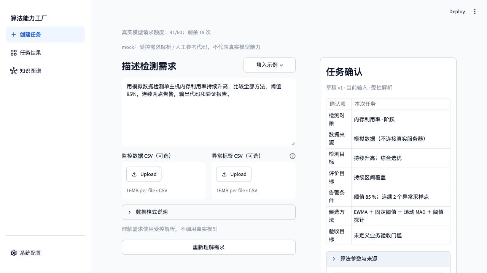
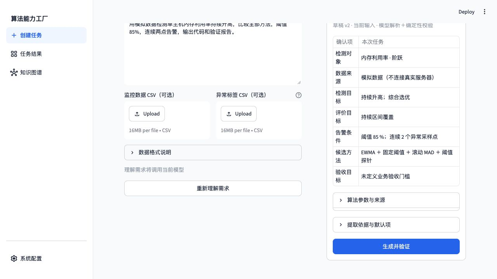
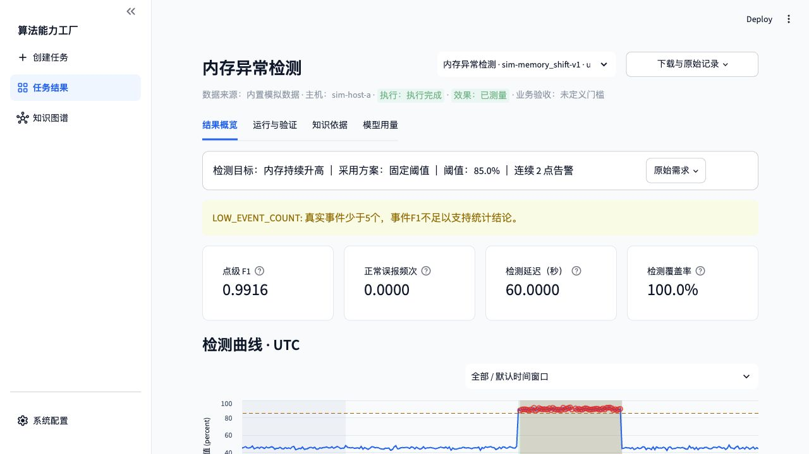
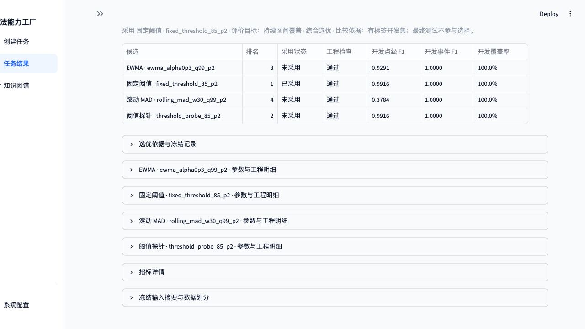
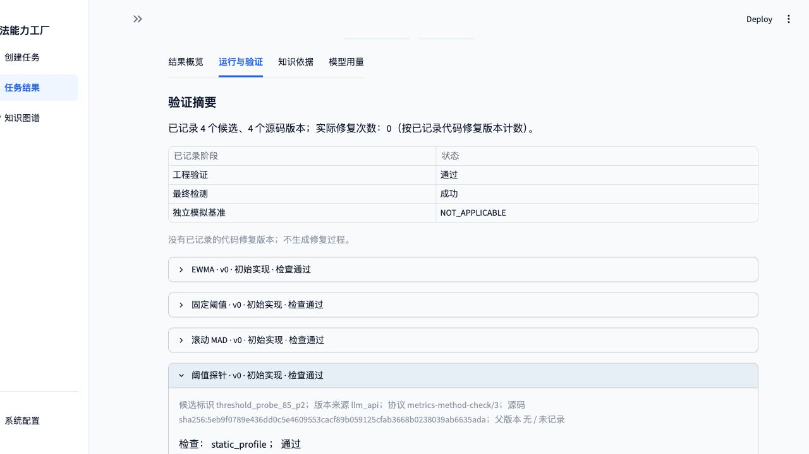
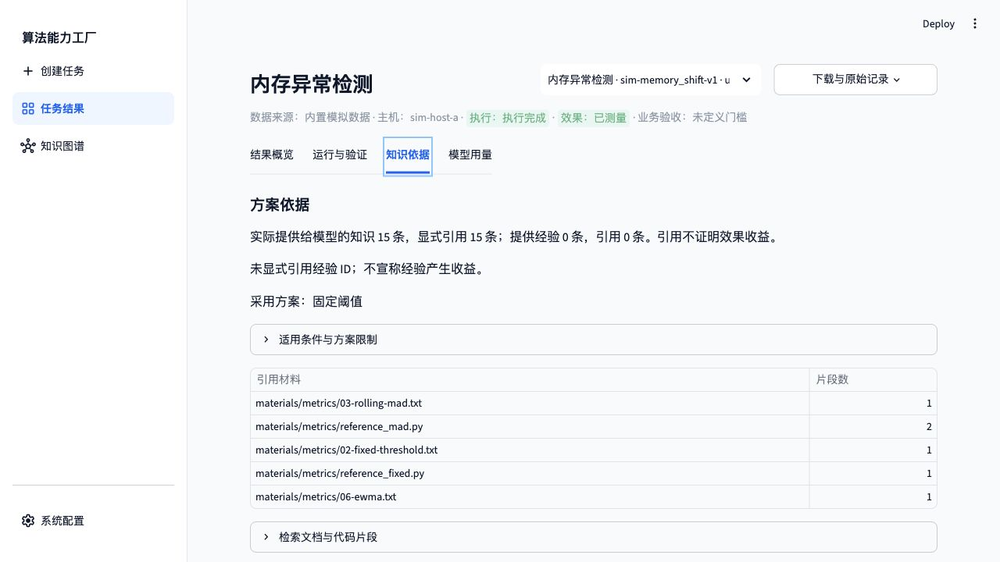
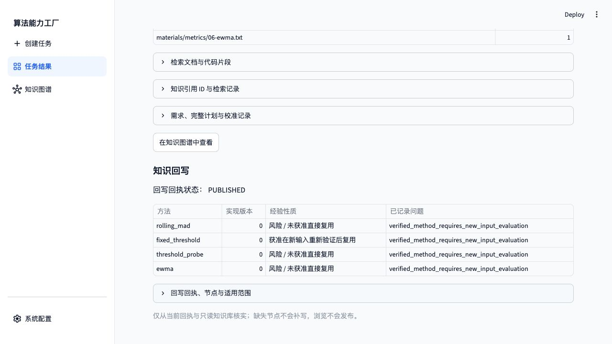

# 材料抽取与插件选择：代码修复及回归验证

日期：2026-11-03（北京时间）。本报告记录代码修复与回归结果。项目执行、测试、真实模型及 Web 服务均在授权服务器的独立验收副本中进行。

## 1. 根因与修复

| 问题 | 根因 | 修改 |
| --- | --- | --- |
| “比较全部/所有方法”只选默认两种 | `controlled_extract` 仅在已识别具体方法名后判断“全部”，无名称时跳过 | 单独识别全量意图，读取当前注册插件；明确列出三种方法时保持三种，不扩成四种 |
| 格式纠错无法准确定位 `method_id` | 结构化校验将嵌套错误压缩为顶层 `capabilities`，传输层也只保留顶层字段 | 在原有错误类型和顶层字段外保留 schema 内的完整路径，例如 `capabilities[0].method_id`；不回显未知字段名或错误输入值 |
| 不完整材料反复出现 `MISSING_FIELD_EVIDENCE` | 初次提示未清楚区分材料摘要与完整算法规格；纠错提示只要求修引用，未说明缺字段的处理方式 | schema 说明区分算法 ID 与依赖环境；统一初次及纠错规则，反馈缺失字段和值。资料不足时由模型输出带原文引用的摘要，完整规格扩展设为 null，不编造元数据 |
| 单份结构化输出失败中断整批导入 | 最终 `MODEL_OUTPUT_INVALID` 越过逐材料检查循环，后续材料和整批报告没有执行 | 逐材料记录 `REJECTED` 和安全错误位置，再检查后续材料；整体仍按有无拒绝记录判定成功或失败 |

保留严格 schema、逐字引用、AST 符号、字段依据和“材料未验证实现”检查；没有人工改写模型响应、把拒绝记录改成成功，或在真实调用失败后切换 Mock。超时、鉴权、网络、预算等调用故障仍会上报，不被重分类为坏材料。

涉及源码：`src/factory/metrics/requirements.py`、`knowledge.py`、`model.py`，`src/contracts/metrics_knowledge.py`，`src/factory/models/checks.py`、`transport.py`。提示版本为 `metrics-prompts/6`，抽取协议为 `metrics-extraction/3`。

## 2. 复现与自动化回归

先把新增回归用例放到服务器原始代码副本执行，得到 **7 failed、7 passed**，复现全量方法漏选、嵌套错误位置丢失、不完整规格反馈不清及批量导入中断。随后修复并补充“明确列出三种方法”的覆盖。

最终源码全量测试：**498 passed、71 skipped、0 failed，73.66 秒**。未配置基础设施的跳过项不计为通过；真实模型、Neo4j 和页面验证另行记录。

回归覆盖包括：未知属性和错误值不会进入安全反馈；材料在初次输出或引用纠错阶段格式失败，均能保留拒绝记录并处理下一份；真正的模型超时仍抛出；资料不足时保留来源事实而不宣称实现已验证；注册第四个非默认插件后全量选择和显式子集选择正确。

证据：[修复前失败](bugfix-evidence/regression-before.txt)、[相关测试](bugfix-evidence/regression-after.txt)、[最终全量测试](bugfix-evidence/full-tests-final.txt)。

## 3. 真实模型全量材料重验

复用已安装依赖和授权模型配置，在新源码副本、新 state 及 Neo4j 命名空间 `bugfix-revalidation-20261103` 中，按 getting-started 的正式 CLI 一次提交完整 `materials/metrics`。没有复用旧抽取节点，没有人工填入失败输出。

模型：`doubao-seed-2-1-pro-260915 / ark_chat`。任务：`ingest-bugfix-20261103-1`。结果为 `SUCCEEDED`，**8/8 份材料全部 `source_checked`**，共 9 次真实请求。`04-evaluation.txt` 发生一次格式纠错后通过；其余 7 份无格式重试，未触发引用纠错。后续在服务器重新读取原始材料，并对保存的模型输出再次执行引用和符号检查，全部通过。

| 材料 | 修复前记录 | 本轮结果 | 抽取能力条目 |
| --- | --- | --- | ---: |
| `01-fields.txt` | 未通过 | 来源校验通过 | 1 |
| `02-fixed-threshold.txt` | 未通过 | 来源校验通过 | 1 |
| `03-rolling-mad.txt` | 未通过 | 来源校验通过 | 1 |
| `04-evaluation.txt` | 通过 | 格式纠错后来源校验通过 | 4 |
| `05-limitations.txt` | 通过 | 来源校验通过 | 3 |
| `06-ewma.txt` | 未通过 | 来源校验通过 | 1 |
| `reference_fixed.py` | 未通过 | 来源与 AST 符号校验通过 | 2 |
| `reference_mad.py` | 未通过 | 来源与 AST 符号校验通过 | 1 |

**本轮 14 个抽取条目都是材料摘要，完整算法规格数为 0，`implementation_verified=false`。** 原材料未同时给出完整规格的全部必需元数据，模型依照规则将规格扩展设为 null，把有依据的算法事实留在摘要、约束和引用中。这不等同于 8 张完整算法卡片，也不证明检测实现正确。可执行的冻结算法规格仍由独立注册的专家插件卡片提供。

证据：[正式导入报告](bugfix-evidence/ingest-report.json)、[保存的知识快照](bugfix-evidence/ingested-snapshot.json)、[独立复核](bugfix-evidence/source-checks.json)、[模型提示和解析结果](bugfix-evidence/ingest-documents.json)、[格式纠错位置](bugfix-evidence/format-corrections.json)。该部分使用指南中的 CLI；当前 Web 没有材料导入入口，未描述为页面导入。

## 4. Web 插件选择重验

在同一授权验收地址 `http://127.0.0.1:18503/` 切换到修复源码。新增 `threshold_probe` 仍为独立副本中的测试插件，不加入正式 `capabilities/`；其卡片和参考文件与[前轮插件夹具](plugin-evidence/threshold_probe/)一致。

1. 在“系统配置”选择 Mock，进入“创建任务”。
2. 输入原缺陷需求，不写任何方法名称，点击“理解需求”。
3. 确认区显示 **EWMA ＋ 固定阈值 ＋ 滚动 MAD ＋ 阈值探针**，而非默认两种；未在 Mock 模式提交生成。
4. 在“系统配置”切回真实模型，再次理解同一需求，确认四种方法、阈值 85%、连续两点。旧 Mock 草稿正确标记为过期，真实解析完成后才允许生成。
5. 点击“生成并验证”，新任务为 `ui-176b9b949a214571`。

> 用模拟数据检测单主机内存利用率持续升高，比较全部方法，阈值85%，连续两点告警，输出代码和验证报告。

真实任务结果为 `COMPLETED / llm_api`，四个候选均在 v0 通过，无代码修复：

| 方法 | 工程检查 | 开发点级 F1 | 排名 |
| --- | --- | ---: | ---: |
| EWMA | 10 条通过 | 0.9291 | 3 |
| 固定阈值 | 8 条通过 | 0.9916 | 1，采用 |
| 滚动 MAD | 12 条通过 | 0.3784 | 4 |
| 阈值探针 | 8 条通过 | 0.9916 | 2 |

最终只评价采用方案，点级 F1 为 0.9916、正常误报频次 0、匹配延迟 60 秒、覆盖率 100%。保留事件数不足提示，没有定义业务门槛，不将工程通过描述为生产效果达标。

新增插件版本明确显示 `llm_api`、`metrics-method-check/3`；真实生成源码摘要为 `sha256:5eb9f0789e436dd0c5e4609553cacf89b059125cfab3668b0238039ab6635ada`。因此本次补足了前轮 Mock 专项未覆盖的“真实模型对新插件生成”验证；未验证该新插件的真实模型修复或无重启安装。

知识提供/引用为 15/15，经验为 0/0；回写状态 `PUBLISHED`，12 个实现、验证和经验节点。服务端重新读取绑定报告、源码摘要和发布回执，并核对浏览器下载 JSON 与服务器原报告完全一致。

证据：[Web 审计](bugfix-evidence/web-checks.json)、[浏览器下载报告](bugfix-evidence/web-report-download.json)、[服务器原报告和源码](bugfix-evidence/web-run/)、[审计汇总](bugfix-evidence/audit-summary.json)。

## 5. 用量、复现及边界

本次新增 **15 次真实请求**：材料导入 9 次、需求理解 1 次、规划及四份代码生成 5 次。生成任务输入/输出 token 为 212,949 / 9,094；本数不含材料导入和需求理解。共享账本从历史累计 42 次增至 57 次，当前第 2 轮预约 47/60，剩余 13 次；未刷新额度、删历史或把失败请求退还。

全量自动化回归使用正式三个插件；随后仅在验收副本加入第四个测试插件进行页面验收。生产 8501 未更新，独立 18503 保留供审查；数据库使用独立命名空间，不改写前轮经验。

最终收紧了结构化错误隔离条件：仅 `structured_output_invalid` 可以作为逐材料拒绝继续处理，凭据内容拒绝等错误仍抛出。该收紧使用新增回归和完整测试验证，没有追加真实请求。真实调用时及最终源码的文件摘要分别保留在 [real-call-source-files.json](bugfix-evidence/real-call-source-files.json) 和 [source-files.json](bugfix-evidence/source-files.json)，保存的真实抽取结果也在最终源码下重新执行来源检查。

本次没有修改模型供应商超时策略，也没有通过调整阈值或评测口径美化原 CPU、磁盘召回率；原失败记录和原四个实验的效果指标保留。自然错误修复成功率、生产检测效果及新插件修复能力仍不在本轮结论内。

复现脚本：[真实导入](bugfix-evidence/run-llm-bugfix-ingest-20261103.py)、[独立审计](bugfix-evidence/audit-llm-bugfix-20261103.py)、[报告校验](bugfix-evidence/validate-llm-bugfix-report-20261103.py)。[附件校验清单](bugfix-evidence/manifest.sha256) · [报告校验结果](bugfix-evidence/report-checks.json)。
