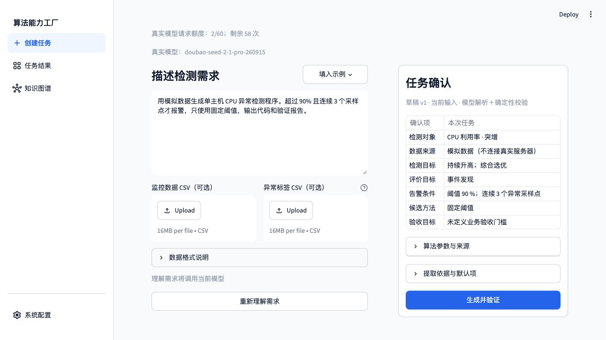
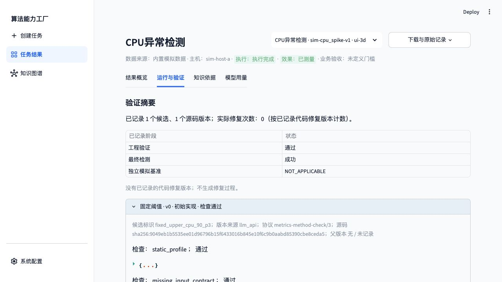
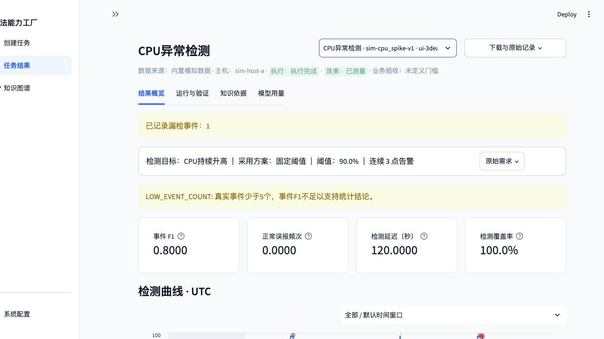
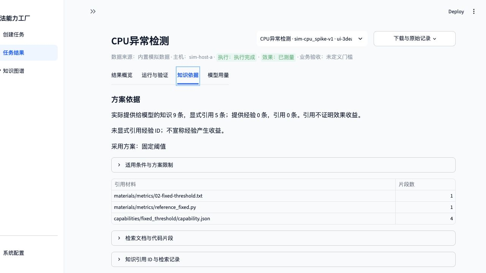
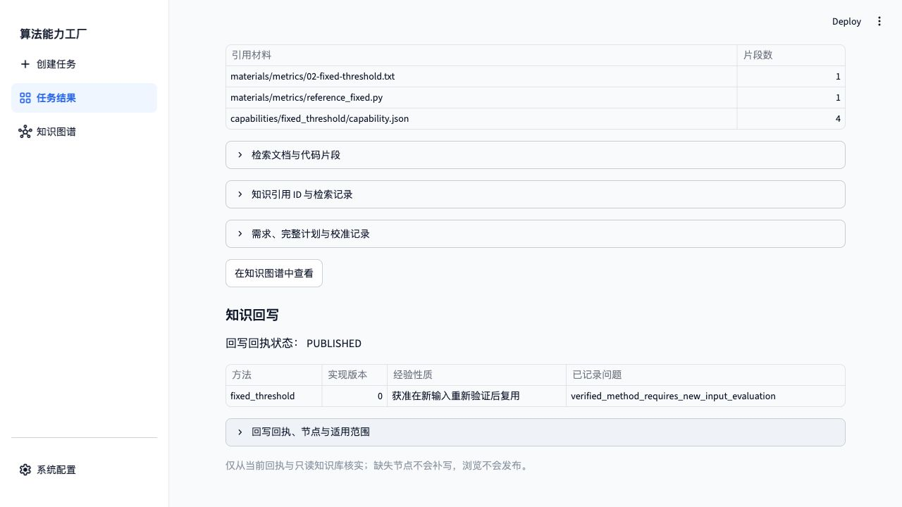

# CPU：单方法生成与验证（最终报告）

验证日期：2026-11-03（北京时间）。真实模型 `doubao-seed-2-1-pro-260915 / ark_chat`；工程协议 `metrics-method-check/3`，效果协议 `metrics-evaluation/1`。项目及模型任务均在授权服务器执行，通过 SSH 转发后的 Web 页面输入、确认、提交和下载。

**结论：单方法真实生成、Docker 工程检查、最终评价、知识回写及浏览器下载核验通过。** 本篇为该场景唯一保留的最终说明报告。

| 项目 | 本轮实际记录 |
| --- | --- |
| 任务 ID | `ui-3dea5cbfa50d4154` |
| 数据 | `sim-cpu_spike-v1`，内置模拟数据 |
| 状态 / 来源 | `COMPLETED / llm_api` |
| 最终采用 | `fixed_upper_cpu_90_p3` |
| 选优目标 / 策略 | `event_detection / balanced` |
| 代码修复次数 | 0 |
| 回写 | `PUBLISHED`，3 个节点 |

## 1. Web 操作与需求确认

1. 打开独立验收页，在系统配置核对真实模型。共享请求账本通过页面授权第 3 轮 60 次，历史调用保留。
2. 进入“创建任务”，不上传 CSV，输入下列原文，点击“理解需求”。
3. 在“任务确认”核对指标、方法、显式参数、连续点数及评价目标，再点击“生成并验证”。
4. 完成后查看“结果概览”的最终指标和候选比较；开发集选优，最终测试不参与选择。
5. 打开“运行与验证”核对版本、来源、协议和检查；在“知识依据”核对引用与发布回执。
6. 下载报告 JSON，在服务器与绑定任务、源码、验证记录和图谱独立核对。

> 用模拟数据生成单主机 CPU 异常检测程序。超过 90% 且连续 3 个采样点才报警，只使用固定阈值，输出代码和验证报告。

## 2. 候选、版本及工程检查

| 候选版本 | 来源 | 工程结果 | 实际检查记录数 |
| --- | --- | --- | ---: |
| `fixed_upper_cpu_90_p3` v0 | `llm_api` | 通过 | 8 |

检查数包括不同层的同名检查，不等于独立属性种类数。最终通过版本为 `reference_verified`，表示通过列出的契约、属性和有限反例参考比较，不是数学证明。

开发集以 事件 Fβ 为主要依据，β=1；下表列点级指标，完整排序次级条件见冻结选优记录。

| 方法 / 候选 | 末版工程检查 | 开发点 Precision | 开发点 Recall | 开发点 Fβ | 排名 |
| --- | --- | ---: | ---: | ---: | ---: |
| 固定阈值 / `fixed_upper_cpu_90_p3` | 8 条通过 | 1.0000 | 0.4444 | 0.6154 | 1 |

- [固定阈值 v0 源码](final-classics-20261103/runs/cpu/candidate-dc9b2f18f5619ee06db95e9689a3ef12f9c98a6ad2c153263b16bb37da87f460/v0.py)；SHA-256 `sha256:9049eb1b5535ee01d96796b15f6433016b845e10f6c9b0aabd85390cbe8ceda5`。

## 3. 最终测试结果

| 指标 | 采用方案的最终测试结果 |
| --- | ---: |
| 计分点 / 真实事件 | 240 / 3 |
| 点 Precision / Recall / F1 | 1.0000 / 0.4444 / 0.6154 |
| 点 TP / FP / FN / TN | 4 / 0 / 5 / 231 |
| 事件 F1；TP / FP / FN | 0.8000；2 / 0 / 1 |
| 匹配延迟中位数 | 120 秒 |
| 正常误报频次 | 0 次/主机小时 |
| 可判定覆盖率 | 100% |

**覆盖率是可判定点比例，不是异常区间召回率。** 保留 `LOW_EVENT_COUNT`，模拟事件少且未定义业务验收门槛，不据此宣称生产效果达标。

连续三点规则仍漏掉较短异常，本轮漏检 1 个事件；零正常误报不等于没有漏检。

## 4. 知识、经验及回写

实际提供知识 9 条、显式引用 5 条；提供经验 0 条、引用 0 条；没有未提供知识引用。算法冻结规格来自专家注册卡片及其引用原文，卡片来源为 `reference`，本次通过实现为 `llm_api`。

独立知识命名空间初始经验数为 0；只复用此前已来源校验的材料，没有复制历史实现或经验，也没有重新执行材料导入。

## 5. 用量、下载及独立核验

生成工作流记录 2 次真实请求，输入/输出 token 29,699 / 2,454，总计 32,153；实际工作流约 58.88 秒。需求理解另计，共享同一账本；用量不完整时不按零计。

四个任务均通过浏览器实际下载报告，解析后与服务器绑定报告一致。所有源码摘要、父版本、冻结规格、插件文件摘要、能力 → 实现 → 验证关系和发布节点均在服务器独立核验。

- [实际下载报告](final-classics-20261103/downloads/cpu-report.json) · [任务审计与真实模型输入摘要](final-classics-20261103/runs/cpu/audit.json)
- [服务器完整报告](final-classics-20261103/runs/cpu/report.json) · [冻结配置与选优](final-classics-20261103/runs/cpu/selection.json)
- [附件校验清单](final-classics-20261103/manifest.sha256) · [报告目录](REPORT.md)
- [实际下载交付 ZIP](final-classics-20261103/downloads/cpu-delivery.zip) · [逐字节及归档完整性核验](final-classics-20261103/cpu-delivery-check.json)
