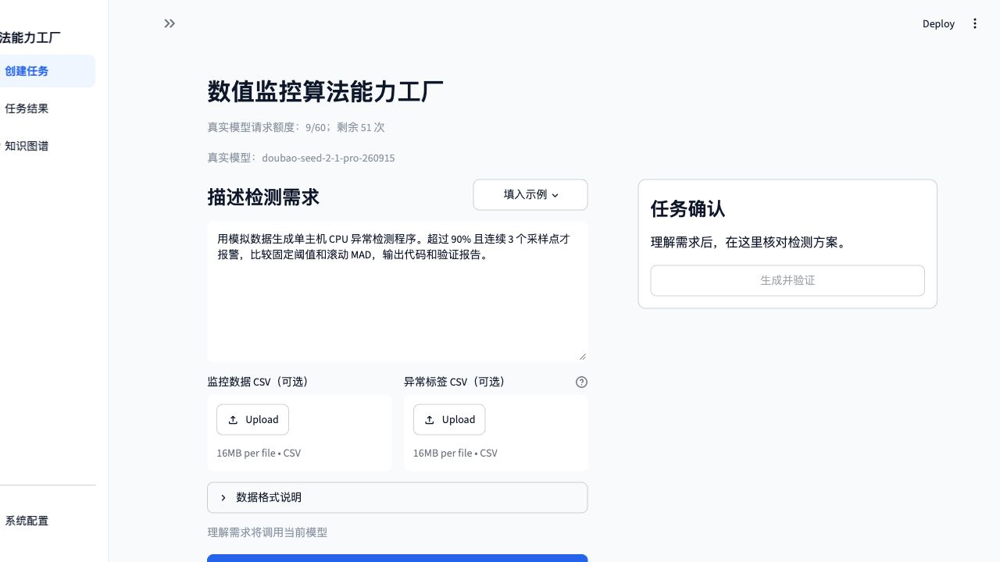
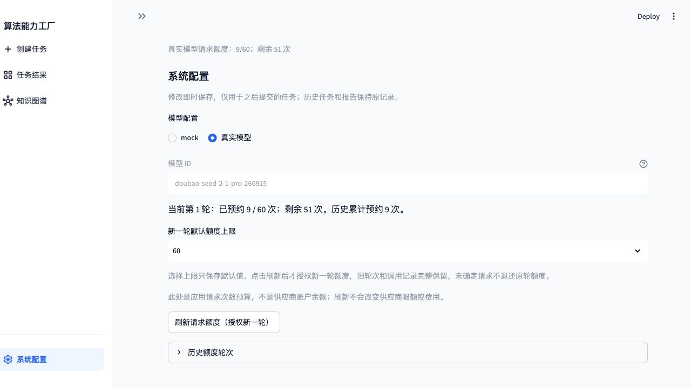
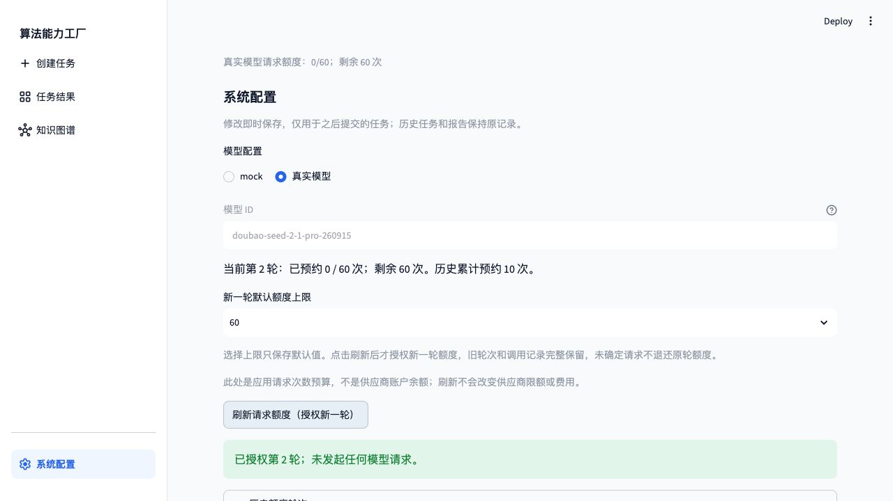

# getting-started.md：服务器环境搭建与真实 Web 验证

验证日期：2026-11-02～11-03（北京时间）。目标文档为 [docs/getting-started.md](../../../docs/getting-started.md)。所有项目安装、CLI、测试、Docker、数据库、Streamlit 和产物核验均在授权服务器完成；本机用于编辑、Git/同步和 SSH 转发后的浏览器交互。

后续状态：2026-11-03 已修复材料抽取提示、字段纠错及批量拒绝记录问题，独立命名空间重验为 **8/8 来源校验通过**，见[修复报告](bugfix-report.md)。下文保留修复前基线的 2/8 结果，不改写历史失败。

**结论：指南能够完成应用安装、数据库和沙箱搭建，真实模型 Web 可提交并完成任务；本轮全量真实材料抽取未通过，不能判为“按指南一次执行全部成功”。** 8 份材料中只有 2 份通过真实抽取校验；后续 Web 算法生成依赖独立库中的专家注册卡片及其原始材料，不能把 Web 成功反推为模型抽取已全部通过。

## 1. 隔离与复现条件

| 项目 | 本轮实际配置 |
| --- | --- |
| 服务器系统 / Python | Debian GNU/Linux 10 / Python 3.12.10 |
| 独立根目录 | `/path/to/llm-factory/real-web-revalidation-20261102/` |
| 源码及依赖 | Git 归档提取至 `demo/`；全新 `demo/.venv/` |
| 私有配置 | 仓库外 `~/.config/llm-factory-web-revalidation-20261102/`，模型/数据库配置与认证文件均为 0600 |
| 状态 | `demo/.runtime/poc`，未复制既有任务或知识库 |
| 数据库 | 新容器 `demo-neo4j-1`，新卷 `demo_neo4j-data`；回环 HTTP/Bolt `17475/17688` |
| 普通 Web | 回环端口 18503，经 SSH 转发访问 |
| 受控修复 Web | 专用回环端口 18504，显式验收提示和注入开关 |
| 真实模型 | `doubao-seed-2-1-pro-260915 / ark_chat` |

主机已有 Linux、Python、Docker 和基础镜像，本轮不属于空白操作系统或新 Docker 安装验收。依赖安装使用当前网络与缓存，镜像构建使用缓存；未测试断网安装。按指南创建模板后，在服务器私有目录复用已授权的真实模型配置，没有打印或导出密钥。

## 2. 按指南执行的步骤和结果

### 2.1 安装及基础测试

从 Git 归档提取至空源码目录，执行：

```sh
make setup
export PYTHONPATH=src:.
.venv/bin/python -m pip check
make test
```

结果：全新 `.venv` 安装成功；`No broken requirements found.`；**488 passed, 71 skipped in 77.58s**，0 failed。跳过项需要显式 Docker/Neo4j 集成配置，不能算作已通过。本轮后续实际 Web 任务另行使用了 Docker 与 Neo4j。

日志：[安装](real-model-revalidation-20261102/environment/setup.txt)、[pip check](real-model-revalidation-20261102/environment/pip-check.txt)、[基础测试](real-model-revalidation-20261102/environment/tests-before-infrastructure.txt)。

### 2.2 模型、Neo4j 和沙箱

设置 `FACTORY_PRIVATE` 和 `FACTORY_SECRET_DIR` 指向上述独立私有目录；按指南创建模型文件并填入已授权配置。为了隔离现有服务，覆盖 Neo4j 端口为 17475/17688，设置 `FACTORY_DOCKER_COMMAND='sudo -n docker'`，执行：

```sh
make neo4j
export FACTORY_KNOWLEDGE_BACKEND=neo4j
export FACTORY_METRICS_KNOWLEDGE="$FACTORY_PRIVATE/knowledge.json"
.venv/bin/python -m factory metrics-knowledge-init --knowledge "$FACTORY_METRICS_KNOWLEDGE"
make sandbox
export FACTORY_METRICS_IMAGE="$(cat .runtime/bootstrap/image-id)"
```

新数据库健康检查、schema/namespace 初始化和镜像构建通过；端口仅绑定回环。沙箱镜像前后完整 ID 一致。官方 `doctor` 的 Python、Docker、镜像、知识库和模型配置五项检查均通过；该检查不发起模型请求，也不证明供应商实际调用必然成功。

证据：[Neo4j 搭建](real-model-revalidation-20261102/environment/neo4j-setup.txt)、[初始化](real-model-revalidation-20261102/environment/knowledge-init.txt)、[镜像构建](real-model-revalidation-20261102/environment/sandbox-build.txt)、[doctor](real-model-revalidation-20261102/environment/doctor.json)、[环境与源码摘要](real-model-revalidation-20261102/environment/environment.json)。

### 2.3 真实材料导入：未全部通过

按指南设置 state、model-env、campaign 后，实际执行全目录 `metrics-ingest --mode api`。首次在 `method_id` 格式校验失败后退出；模型把 `metrics-py312-stdlib/1` 依赖标识写入该字段，斜线不满足 Identifier 约束，内置格式纠正未解决。此前材料也出现 `MISSING_FIELD_EVIDENCE`，没有被擅自认定成功。

保留首次调用及状态，使用正式 `--sources` 参数重试剩余材料；随后按单份材料最多两次尝试恢复，没有人工改写模型结果或切换 Mock。最终如下：

| 材料 | 本轮真实抽取校验 |
| --- | --- |
| `01-fields.txt` | 未通过，缺失逐字段依据 |
| `02-fixed-threshold.txt` | 未通过，结构化标识/字段依据问题 |
| `03-rolling-mad.txt` | 未通过结构化输出校验 |
| `04-evaluation.txt` | `source_checked` |
| `05-limitations.txt` | `source_checked` |
| `06-ewma.txt` | 未通过字段依据/结构化输出校验 |
| `reference_fixed.py` | 未通过字段依据校验 |
| `reference_mad.py` | 未通过结构化输出校验 |

因此全量真实抽取是 **2/8 通过**。专家插件注册在抽取之前完成，固定阈值、MAD、EWMA 卡片及引用原文仍可供后续真实生成；其来源保持 `reference`，不是模型成功抽取的算法证据。本轮没有用旧数据库或 Mock 材料填补这些失败。

证据：[首次失败日志](real-model-revalidation-20261102/environment/real-ingest.stderr)、[精确字段问题](real-model-revalidation-20261102/environment/ingest-schema-issues.json)、[有界单材料重试](real-model-revalidation-20261102/environment/material-recovery.json)、[全部抽取检查](real-model-revalidation-20261102/audit/extraction-checks.json)、[最终材料状态](real-model-revalidation-20261102/audit/results-summary.json)。

### 2.4 启动 Web、授权额度并提交任务

保留同一组环境变量，以 `STREAMLIT_SERVER_PORT=18503 make web` 启动独立页；端口覆盖用于隔离现有 8501。浏览器经 SSH 转发访问，未在本机运行项目服务。

进入“系统配置”确认真实模型，实际点击“刷新请求额度（授权新一轮）”，建立第 2 轮 60 次额度，旧轮仍保留。随后通过页面执行四个实验，下表链接为该轮原始报告；最新四个实验见[最终报告目录](REPORT.md)。







| 实验 | 最终结果与证据 |
| --- | --- |
| [CPU 单方法](real-model-revalidation-20261102/audit/runs/cpu/report.json) | 新任务 v0 通过；页面结果、下载及服务器核验完成 |
| [内存三候选](real-model-revalidation-20261102/audit/runs/memory/report.json) | 三个 v0 通过，采用 EWMA；新经验回写完成 |
| [磁盘后续引用](real-model-revalidation-20261102/audit/runs/disk/report.json) | 首次真实超时，页面新建重试成功；本轮内存经验被提供并引用 |
| [失败修复](real-model-revalidation-20261102/audit/runs/repair/report.json) | 经用户授权的受控 v0 故障失败，真实模型 v1 修复通过 |

磁盘成功任务的自动页面读取曾受浏览器权限拒绝，未绕过。2026-11-03 用户补充了“结果概览”和“知识依据”两张原始 PNG，显示值与服务器记录一致，成功页可视证据已补入报告。目前共 38 张截图，其中 36 张由验收会话获取、2 张由用户提供。完整候选比较、经验 ID 和发布回执仍以服务器原始产物核验；用户截图未展示的内容不据此推断。

## 3. 独立核验、用量及收尾

服务器审计确认：四个成功任务及一个保留的超时失败；各版源码摘要、插件版本/规格和验证记录一致；修复父版本绑定正确；能力 → 实现 → 验证关系存在；本轮内存经验出现在磁盘真实代码生成 prompt 和产物引用中。

CPU、内存、修复及首次磁盘失败的浏览器报告与服务器结构一致；CPU ZIP 逐字节一致并通过 73 条目完整性检查。成功磁盘报告从服务器同步，未描述为浏览器下载。[审计汇总](real-model-revalidation-20261102/audit/audit-summary.json)和[审计脚本](real-model-revalidation-20261102/environment/audit-real-web-experiments.py)可复核。

整个独立账本累计预约并发送 42 次真实请求，含导入、理解、生成、修复和失败：第 1 轮 10 次，第 2 轮 32 次，剩余 28 次。未删除或重置历史；超时请求缺少 token 回报，未当作 0。[最终账本](real-model-revalidation-20261102/audit/budget-after.json)。

结论适用于当前服务器前置条件与源码/可编辑安装。未验证空白 OS、断网、独立 wheel、生产效果或真实监控数据。模拟任务工程通过与完整真实材料抽取通过分别判定。
