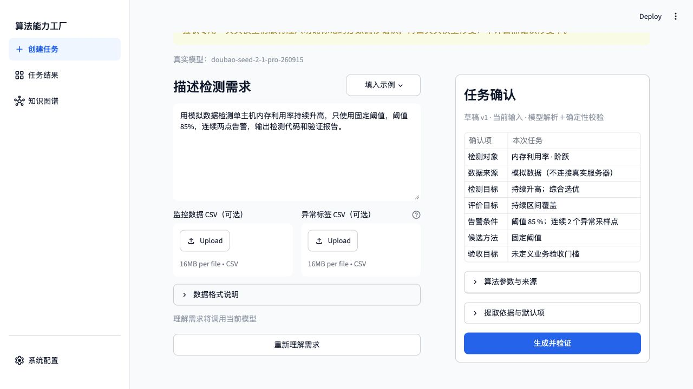
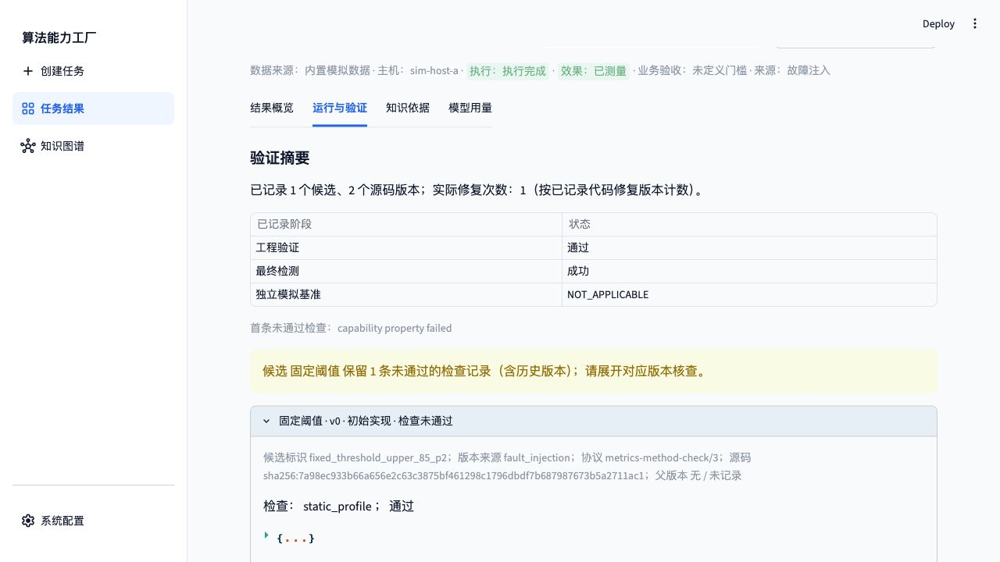
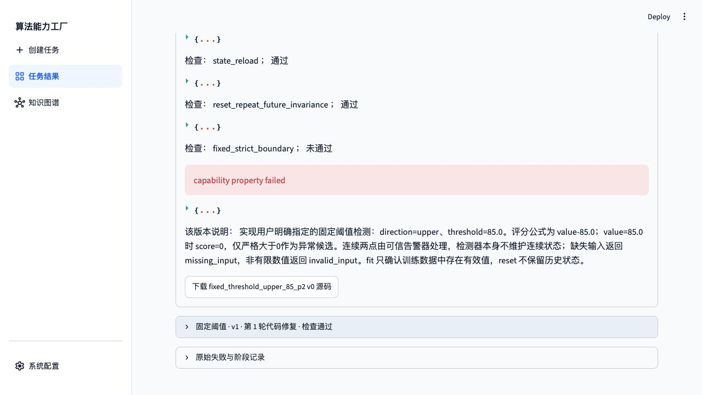
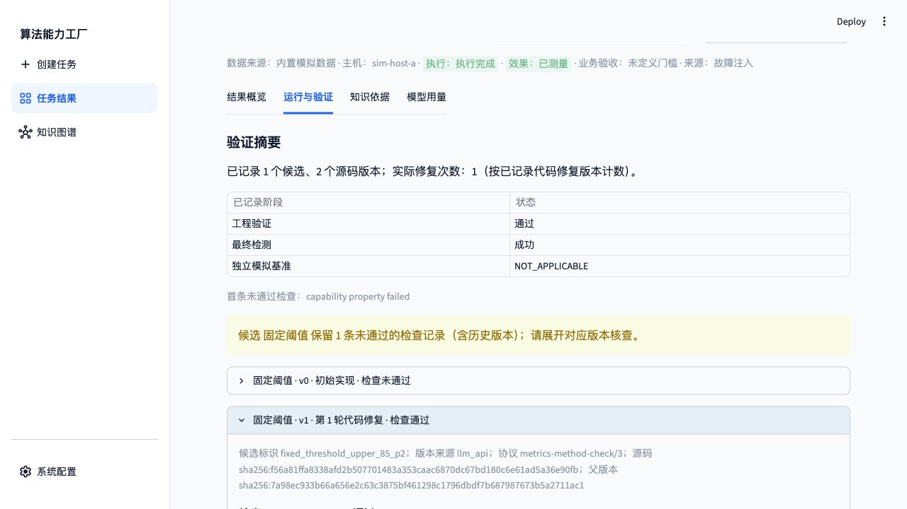
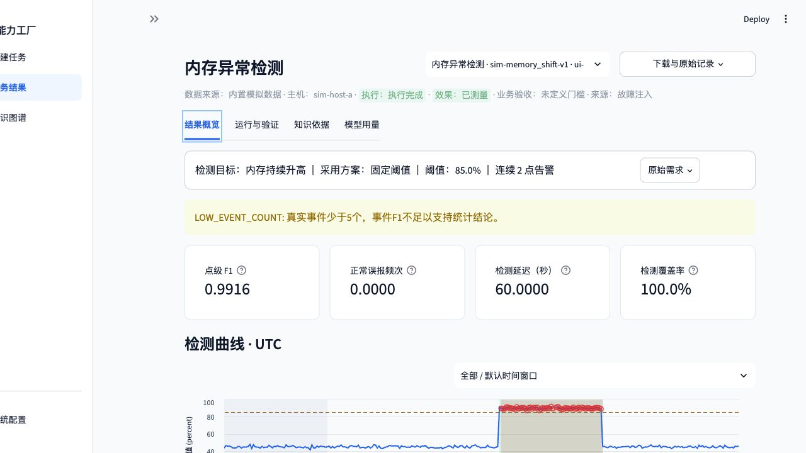
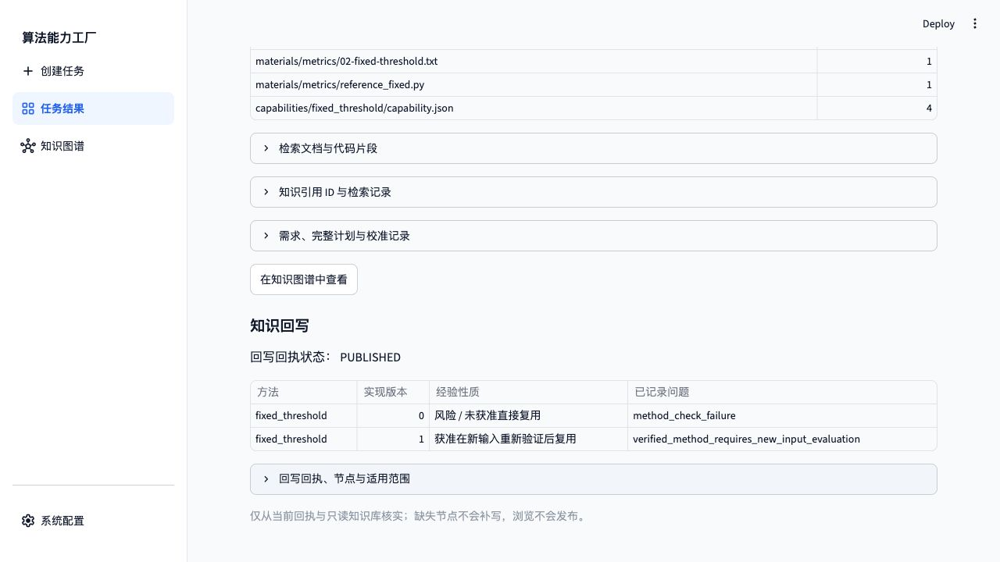
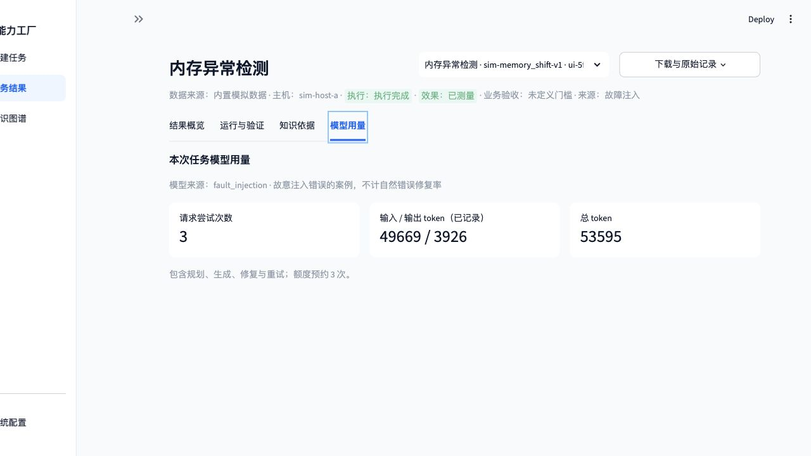

# 失败修复与版本追溯：受控故障（最终报告）

验证日期：2026-11-03（北京时间）。真实模型 `doubao-seed-2-1-pro-260915 / ark_chat`；工程协议 `metrics-method-check/3`，效果协议 `metrics-evaluation/1`。项目及模型任务均在授权服务器执行，通过 SSH 转发后的 Web 页面输入、确认、提交和下载。

**结论：受控 v0 故障被检查拒绝，真实模型按反馈生成 v1 并通过复验；父版本关联和知识回写通过。** 本篇为该场景唯一保留的最终说明报告。

| 项目 | 本轮实际记录 |
| --- | --- |
| 任务 ID | `ui-5f4299d229da4349` |
| 数据 | `sim-memory_shift-v1`，内置模拟数据 |
| 状态 / 来源 | `COMPLETED / fault_injection` |
| 最终采用 | `fixed_threshold_upper_85_p2` |
| 选优目标 / 策略 | `sustained_coverage / balanced` |
| 代码修复次数 | 1 |
| 回写 | `PUBLISHED`，6 个节点 |

## 1. Web 操作与需求确认

1. 打开独立验收页，在系统配置核对真实模型。共享请求账本通过页面授权第 3 轮 60 次，历史调用保留。
2. 进入“创建任务”，不上传 CSV，输入下列原文，点击“理解需求”。
3. 在“任务确认”核对指标、方法、显式参数、连续点数及评价目标，再点击“生成并验证”。
4. 完成后查看“结果概览”的最终指标和候选比较；开发集选优，最终测试不参与选择。
5. 打开“运行与验证”核对版本、来源、协议和检查；在“知识依据”核对引用与发布回执。
6. 下载报告 JSON，在服务器与绑定任务、源码、验证记录和图谱独立核对。

> 用模拟数据检测单主机内存利用率持续升高，只使用固定阈值，阈值 85%，连续两点告警，输出检测代码和验证报告。

修复实验使用独立 18504 页面，先显示明确故障注入提示。仅验收副本将页面提交连接到已有 `fault_injection` 开关，原有生成、验证、修复算法均未改动；普通三个场景的注入开关为 false。

真实模型原稿单独保留，再对 v0 有效输出分数加 1.0，故意触发边界属性失败；原稿未单独复验，不宣称注入前已通过。v1 由真实模型根据 `previous_source` 和 `development_feedback` 生成。此案例不计自然错误修复率。

## 2. 候选、版本及工程检查

| 候选版本 | 来源 | 工程结果 | 实际检查记录数 |
| --- | --- | --- | ---: |
| `fixed_threshold_upper_85_p2` v0 | `fault_injection` | 未通过 | 5 |
| `fixed_threshold_upper_85_p2` v1 | `llm_api` | 通过 | 8 |

检查数包括不同层的同名检查，不等于独立属性种类数。最终通过版本为 `reference_verified`，表示通过列出的契约、属性和有限反例参考比较，不是数学证明。

开发集以 点级 Fβ 为主要依据，β=1；下表列点级指标，完整排序次级条件见冻结选优记录。

| 方法 / 候选 | 末版工程检查 | 开发点 Precision | 开发点 Recall | 开发点 Fβ | 排名 |
| --- | --- | ---: | ---: | ---: | ---: |
| 固定阈值 / `fixed_threshold_upper_85_p2` | 8 条通过 | 1.0000 | 0.9833 | 0.9916 | 1 |

v1 的父版本摘要为 `sha256:7a98ec933b66a656e2c63c3875bf461298c1796dbdf7b687987673b5a2711ac1`，与实际失败 v0 的 `sha256:7a98ec933b66a656e2c63c3875bf461298c1796dbdf7b687987673b5a2711ac1` 一致。失败与通过版本都保留，没有覆盖 v0。

- [固定阈值 v0 源码](final-classics-20261103/runs/repair/candidate-7e28edc5e837ce161ffe7d64866aa375ca7913b2249e6f7f02ed1e4a7b302edb/v0.py)；SHA-256 `sha256:7a98ec933b66a656e2c63c3875bf461298c1796dbdf7b687987673b5a2711ac1`。
- [固定阈值 v1 源码](final-classics-20261103/runs/repair/candidate-7e28edc5e837ce161ffe7d64866aa375ca7913b2249e6f7f02ed1e4a7b302edb/v1.py)；SHA-256 `sha256:f56a81ffa8338afd2b507701483a353caac6870dc67bd180c6e61ad5a36e90fb`。

## 3. 最终测试结果

| 指标 | 采用方案的最终测试结果 |
| --- | ---: |
| 计分点 / 真实事件 | 240 / 1 |
| 点 Precision / Recall / F1 | 1.0000 / 0.9833 / 0.9916 |
| 点 TP / FP / FN / TN | 59 / 0 / 1 / 180 |
| 事件 F1；TP / FP / FN | 1.0000；1 / 0 / 0 |
| 匹配延迟中位数 | 60 秒 |
| 正常误报频次 | 0 次/主机小时 |
| 可判定覆盖率 | 100% |

**覆盖率是可判定点比例，不是异常区间召回率。** 保留 `LOW_EVENT_COUNT`，模拟事件少且未定义业务验收门槛，不据此宣称生产效果达标。

## 4. 知识、经验及回写

实际提供知识 9 条、显式引用 3 条；提供经验 0 条、引用 0 条；没有未提供知识引用。算法冻结规格来自专家注册卡片及其引用原文，卡片来源为 `reference`，本次通过实现为 `llm_api`。

独立知识命名空间初始经验数为 0；只复用此前已来源校验的材料，没有复制历史实现或经验，也没有重新执行材料导入。

回写同时保留失败 v0、通过 v1、对应检查和经验；整体任务仍标记 `fault_injection`。

## 5. 用量、下载及独立核验

生成工作流记录 3 次真实请求，输入/输出 token 49,669 / 3,926，总计 53,595；实际工作流约 115.35 秒。需求理解另计，共享同一账本；用量不完整时不按零计。

四个任务均通过浏览器实际下载报告，解析后与服务器绑定报告一致。所有源码摘要、父版本、冻结规格、插件文件摘要、能力 → 实现 → 验证关系和发布节点均在服务器独立核验。

- [实际下载报告](final-classics-20261103/downloads/repair-report.json) · [任务审计与真实模型输入摘要](final-classics-20261103/runs/repair/audit.json)
- [服务器完整报告](final-classics-20261103/runs/repair/report.json) · [冻结配置与选优](final-classics-20261103/runs/repair/selection.json)
- [附件校验清单](final-classics-20261103/manifest.sha256) · [报告目录](REPORT.md)

