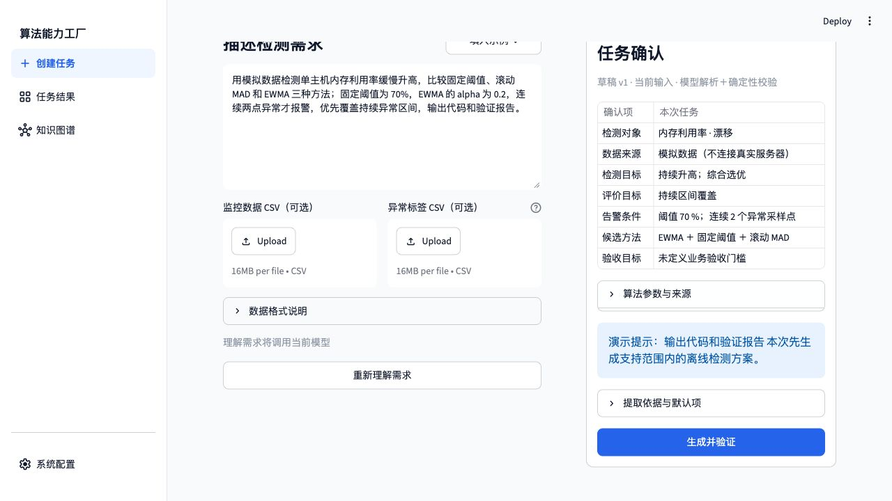
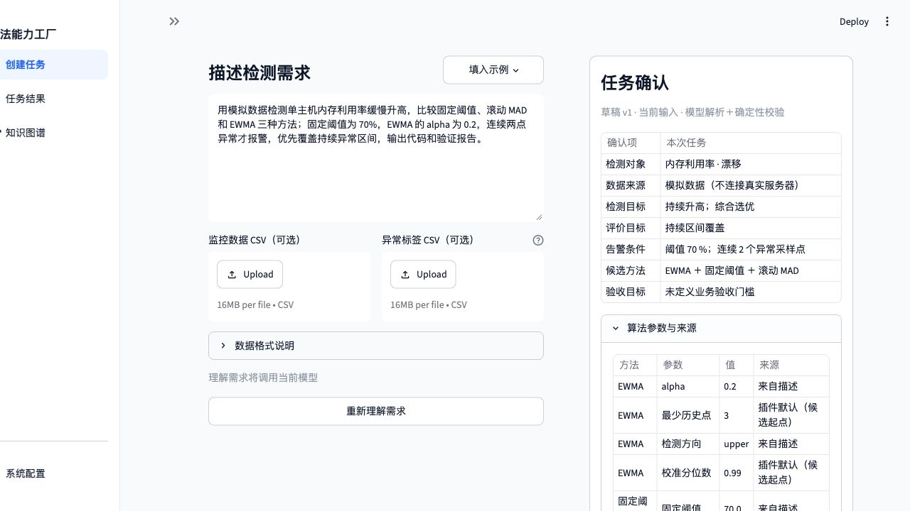
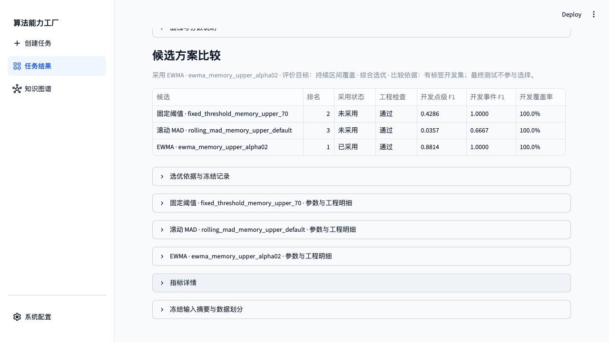
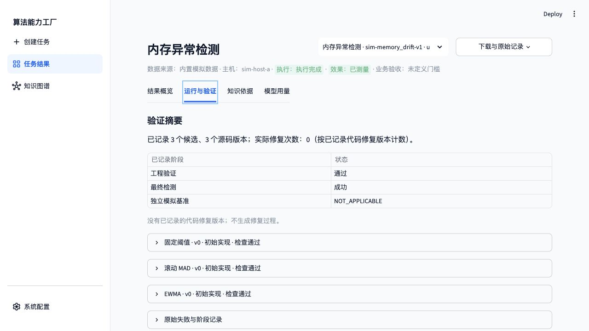
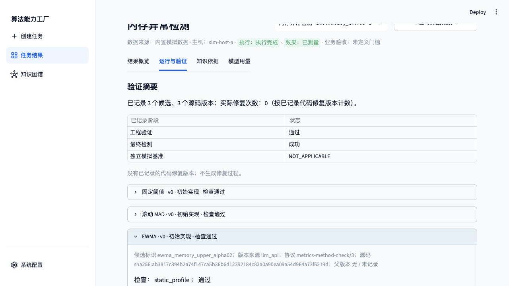
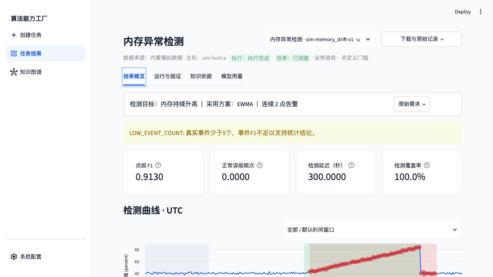
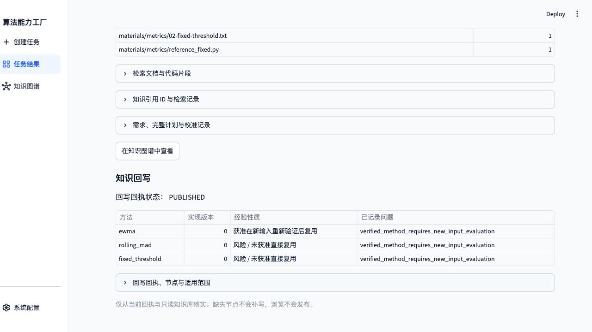

# 内存漂移：三候选比较与选优（最终报告）

验证日期：2026-11-03（北京时间）。真实模型 `doubao-seed-2-1-pro-260915 / ark_chat`；工程协议 `metrics-method-check/3`，效果协议 `metrics-evaluation/1`。项目及模型任务均在授权服务器执行，通过 SSH 转发后的 Web 页面输入、确认、提交和下载。

**结论：三种方法均首次工程检查通过，按有标签开发集选优，再对 EWMA 执行最终测试。** 本篇为该场景唯一保留的最终说明报告。

| 项目 | 本轮实际记录 |
| --- | --- |
| 任务 ID | `ui-1deabf9ab9634a9a` |
| 数据 | `sim-memory_drift-v1`，内置模拟数据 |
| 状态 / 来源 | `COMPLETED / llm_api` |
| 最终采用 | `ewma_memory_upper_alpha02` |
| 选优目标 / 策略 | `sustained_coverage / balanced` |
| 代码修复次数 | 0 |
| 回写 | `PUBLISHED`，9 个节点 |

## 1. Web 操作与需求确认

1. 打开独立验收页，在系统配置核对真实模型。共享请求账本通过页面授权第 3 轮 60 次，历史调用保留。
2. 进入“创建任务”，不上传 CSV，输入下列原文，点击“理解需求”。
3. 在“任务确认”核对指标、方法、显式参数、连续点数及评价目标，再点击“生成并验证”。
4. 完成后查看“结果概览”的最终指标和候选比较；开发集选优，最终测试不参与选择。
5. 打开“运行与验证”核对版本、来源、协议和检查；在“知识依据”核对引用与发布回执。
6. 下载报告 JSON，在服务器与绑定任务、源码、验证记录和图谱独立核对。

> 用模拟数据检测单主机内存利用率缓慢升高，比较固定阈值、滚动 MAD 和 EWMA 三种方法；固定阈值为 70%，EWMA 的 alpha 为 0.2，连续两点异常才报警，优先覆盖持续异常区间，输出代码和验证报告。

## 2. 候选、版本及工程检查

| 候选版本 | 来源 | 工程结果 | 实际检查记录数 |
| --- | --- | --- | ---: |
| `fixed_threshold_memory_upper_70` v0 | `llm_api` | 通过 | 8 |
| `rolling_mad_memory_upper_default` v0 | `llm_api` | 通过 | 12 |
| `ewma_memory_upper_alpha02` v0 | `llm_api` | 通过 | 10 |

检查数包括不同层的同名检查，不等于独立属性种类数。最终通过版本为 `reference_verified`，表示通过列出的契约、属性和有限反例参考比较，不是数学证明。

开发集以 点级 Fβ 为主要依据，β=1；下表列点级指标，完整排序次级条件见冻结选优记录。

| 方法 / 候选 | 末版工程检查 | 开发点 Precision | 开发点 Recall | 开发点 Fβ | 排名 |
| --- | --- | ---: | ---: | ---: | ---: |
| 固定阈值 / `fixed_threshold_memory_upper_70` | 8 条通过 | 1.0000 | 0.2727 | 0.4286 | 2 |
| 滚动 MAD / `rolling_mad_memory_upper_default` | 12 条通过 | 1.0000 | 0.0182 | 0.0357 | 3 |
| EWMA / `ewma_memory_upper_alpha02` | 10 条通过 | 0.8254 | 0.9455 | 0.8814 | 1 |

- [固定阈值 v0 源码](final-classics-20261103/runs/memory/candidate-ee488d83f2be3a63c3bf1b4ce55e059b9a5f8166e910926b4f1717917536c02e/v0.py)；SHA-256 `sha256:90b2a9efbd95378a55d5bdaa5a62b4c3c80b2de4dcd5d4fd0560e5ee2f48f899`。
- [滚动 MAD v0 源码](final-classics-20261103/runs/memory/candidate-cce35994780269d48115a68b57f08e142bb2bb94d94e289ae7536fb379c7e076/v0.py)；SHA-256 `sha256:18f4daca57291020804eafd97672131f33b8fbe99f9500a2cd07d514b32fbd8b`。
- [EWMA v0 源码](final-classics-20261103/runs/memory/candidate-f8e383a9e6e045eb20e3da125d037cf5987c71070e859b91b3e79a8c2003974e/v0.py)；SHA-256 `sha256:ab3817c394b2a74f147ca5b36b6d12392184c83a0a90ea09a54d964a73f6219d`。

## 3. 最终测试结果

| 指标 | 采用方案的最终测试结果 |
| --- | ---: |
| 计分点 / 真实事件 | 240 / 1 |
| 点 Precision / Recall / F1 | 0.8750 / 0.9545 / 0.9130 |
| 点 TP / FP / FN / TN | 105 / 15 / 5 / 115 |
| 事件 F1；TP / FP / FN | 1.0000；1 / 0 / 0 |
| 匹配延迟中位数 | 300 秒 |
| 正常误报频次 | 0 次/主机小时 |
| 可判定覆盖率 | 100% |

**覆盖率是可判定点比例，不是异常区间召回率。** 保留 `LOW_EVENT_COUNT`，模拟事件少且未定义业务验收门槛，不据此宣称生产效果达标。

本轮有 15 个点级误报和 5 个漏检点。正常误报频次按事件口径计数，不能用其为零推断点级 FP 为零。开发点级 F1 与最终测试值分开保留，不沿用旧轮指标。

## 4. 知识、经验及回写

实际提供知识 15 条、显式引用 10 条；提供经验 1 条、引用 1 条；没有未提供知识引用。算法冻结规格来自专家注册卡片及其引用原文，卡片来源为 `reference`，本次通过实现为 `llm_api`。

独立知识命名空间初始经验数为 0；只复用此前已来源校验的材料，没有复制历史实现或经验，也没有重新执行材料导入。

本轮固定阈值候选还显式引用了本轮 CPU 任务的经验；内存任务本身完成后再发布三种方法的经验。EWMA 被采用，MAD 与固定阈值的经验保留为需重新评价的风险提示。

## 5. 用量、下载及独立核验

生成工作流记录 4 次真实请求，输入/输出 token 144,310 / 7,585，总计 151,895；实际工作流约 209.05 秒。需求理解另计，共享同一账本；用量不完整时不按零计。

四个任务均通过浏览器实际下载报告，解析后与服务器绑定报告一致。所有源码摘要、父版本、冻结规格、插件文件摘要、能力 → 实现 → 验证关系和发布节点均在服务器独立核验。

- [实际下载报告](final-classics-20261103/downloads/memory-report.json) · [任务审计与真实模型输入摘要](final-classics-20261103/runs/memory/audit.json)
- [服务器完整报告](final-classics-20261103/runs/memory/report.json) · [冻结配置与选优](final-classics-20261103/runs/memory/selection.json)
- [附件校验清单](final-classics-20261103/manifest.sha256) · [报告目录](REPORT.md)
