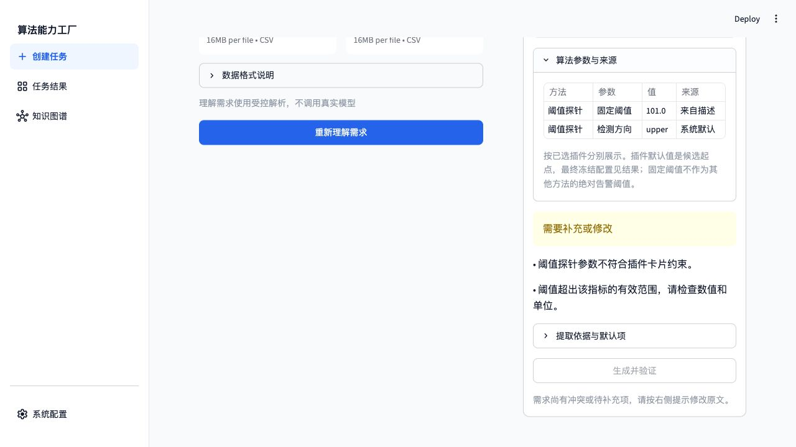
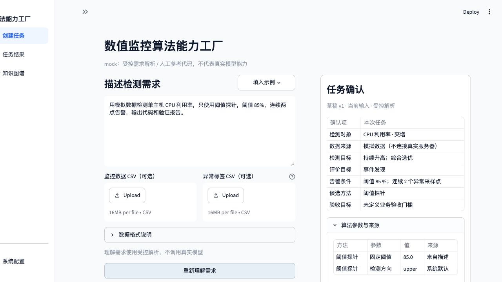
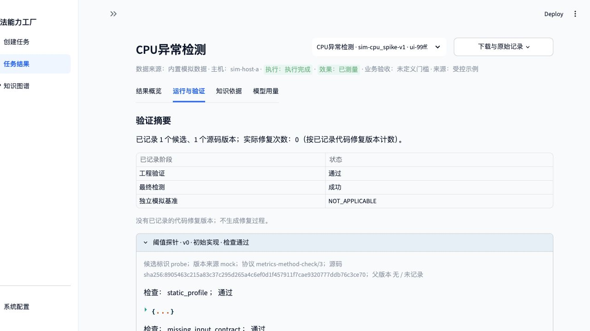
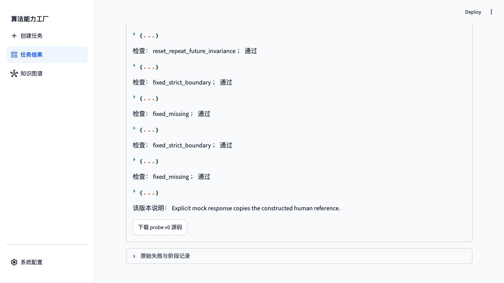
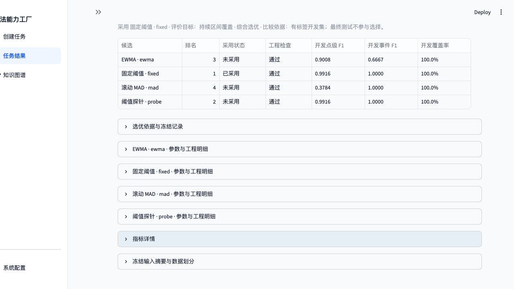
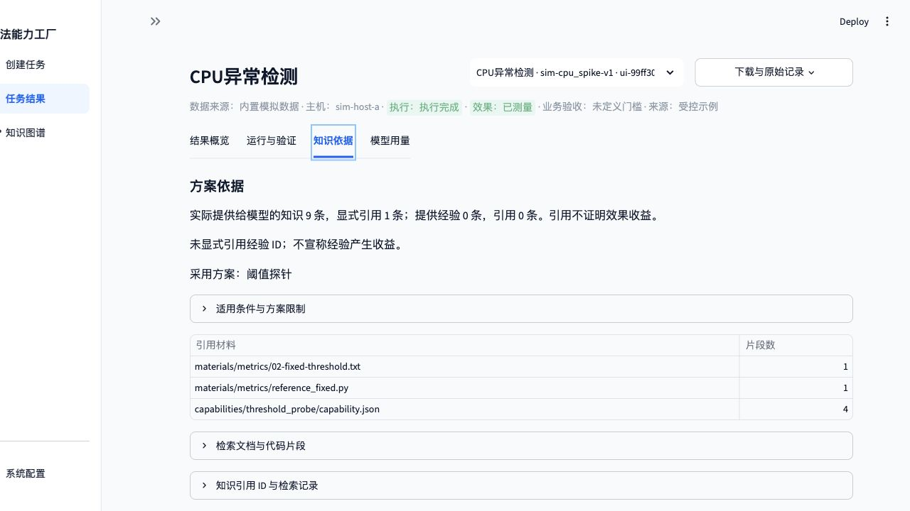
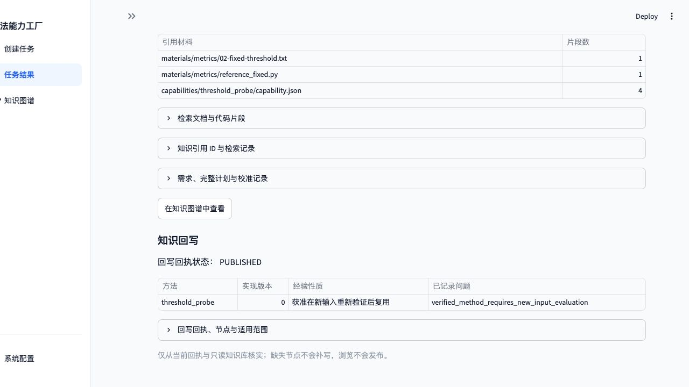
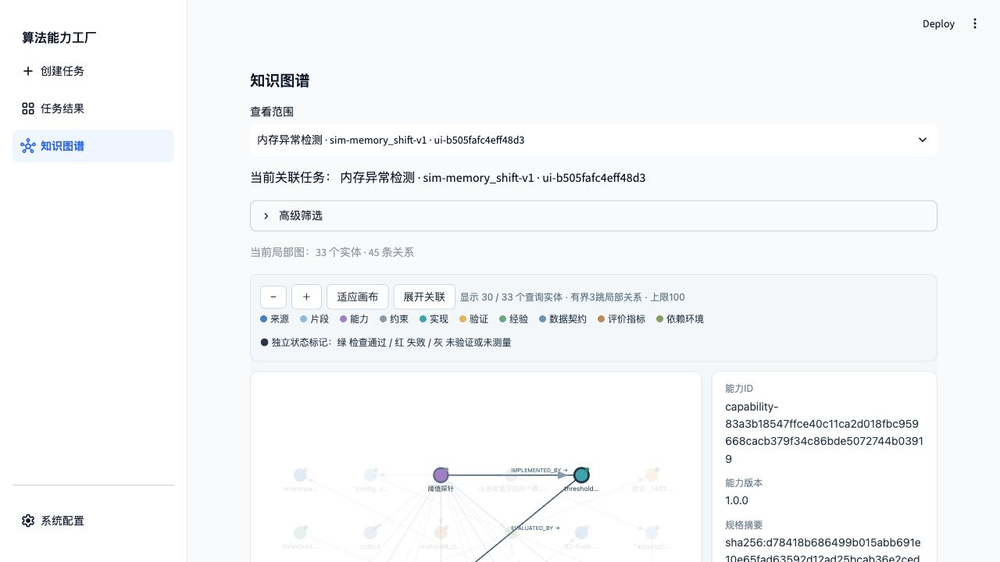
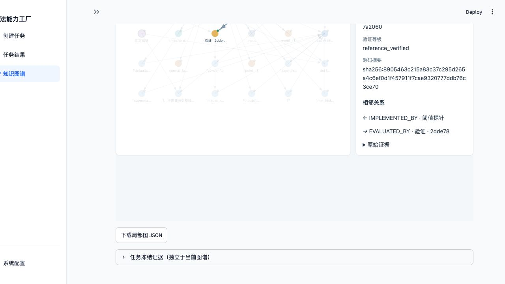
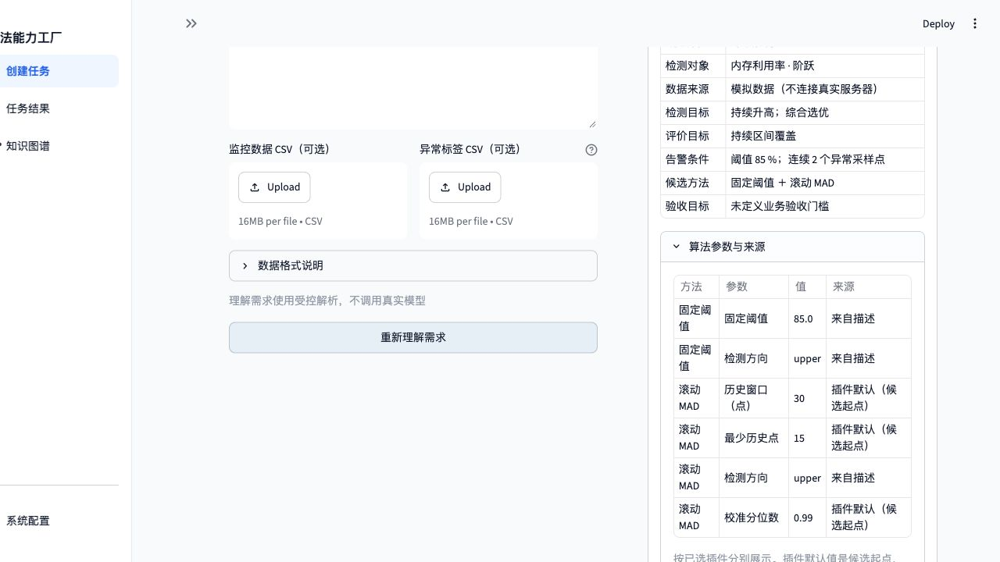

# 插件机制：新增能力与 Web 闭环验证

验证日期：2026-11-02（北京时间）。本次在独立服务器环境中新执行，通过真实浏览器输入、点击、下载和刷新完成两个任务。模型模式为 **Mock**，真实模型请求与 token 均为 0。

后续状态：2026-11-03 已修复 U01，并完成新增插件的真实模型生成验证，四个候选均在 v0 通过；该新增插件的真实模型修复能力仍未验证。详见[修复与回归报告](bugfix-report.md)。下文为 2026-11-02 Mock 专项的历史结果。

**当次结论：单主机、单数值指标异常检测接口内，插件的发现、参数校验、单插件执行、多插件共存、验证及知识追溯通过；另发现 1 项 Mock 需求解析限制。** 补充的插件专项测试为 **14 passed、0 failed、0 skipped**，包含无参考插件的真实 Docker 验证。Web 结果与补充测试分别记录如下。

## 1. 环境和测试插件

从 Git 归档建立独立源码目录和全新 `.venv`，使用锁定依赖、独立 SQLite 知识库和任务状态。项目安装、CLI、测试、Streamlit、Docker 及产物核验全部在授权服务器执行；本机用于文件编辑、同步以及经 SSH 转发访问页面。

| 项目 | 本轮配置 |
| --- | --- |
| 远程验收目录 | `/path/to/llm-factory/plugin-web-verification-20261102/` |
| 源码 / 虚拟环境 | `demo/`、`demo/.venv/` |
| 知识 / 状态 | `state/knowledge.sqlite`、`state/knowledge.json`、`state/ui/` |
| Web | 服务器回环地址 `127.0.0.1:18502`，浏览器通过同端口 SSH 转发访问 |
| 执行方式 | `FACTORY_DOCKER_COMMAND='sudo -n docker'`；沙箱固定为[完整镜像 ID](plugin-evidence/image-id.txt) |
| 原有插件 | `ewma`、`fixed_threshold`、`rolling_mad` |
| 新测试插件 | `threshold_probe`，显示名“阈值探针”，版本 `1.0.0`，不作为默认候选 |

测试插件仅安装在独立验收副本的 `capabilities/threshold_probe/`。其[能力描述](plugin-evidence/threshold_probe/capability.json)、[属性检查](plugin-evidence/threshold_probe/checks.py)、[参考实现](plugin-evidence/threshold_probe/reference.py)保存为附件夹具，没有加入正式 `capabilities/`。

阈值探针复用固定阈值参考算法及原始材料，另声明 `0 ≤ threshold ≤ 100` 的参数约束，用于验证新方法身份、别名、配置和完整执行链。它不是一种新发明的检测算法。插件安装通过服务器文件操作完成，Web 承担需求提交和运行验收；当前页面没有插件上传或安装管理功能。

安装前后 `src/` 摘要一致；与原始 Git 归档逐字节比较，原有 `src/`、`scripts/`、`capabilities/`、`materials/` 共 **116 个文件全部一致**。没有通过修改核心代码加入该方法，依据见[安装记录](plugin-evidence/installation.json)及[独立核验结果](plugin-evidence/evidence-checks.json)。

## 2. Web 验收清单

| 编号 | 页面操作与实际观察 | 结果 |
| --- | --- | --- |
| P01 | 系统配置选择 Mock；创建任务输入“只使用阈值探针”并理解需求 | 识别新增别名，只选择 `threshold_probe` |
| P02 | 新插件阈值为 101%，点击理解需求 | 显示“阈值探针参数不符合插件卡片约束”，生成按钮禁用；同时显示 CPU 百分比越界提示 |
| P03 | 改为阈值 85%、连续两点，重新理解并点击“生成并验证” | 新建单候选任务，工程验证及最终评价完成 |
| P04 | 打开单候选任务“运行与验证”，展开 v0 | 8 条检查记录通过，协议 `metrics-method-check/3`，实际修复次数 0 |
| P05 | 打开“知识依据” | 显示新插件卡片及原始材料，回写回执 `PUBLISHED` |
| P06 | 显式输入固定阈值、滚动 MAD、EWMA 和阈值探针，再生成 | 四个候选均通过；新插件参与排名，采用固定阈值 |
| P07 | 从任务进入知识图谱，按 `threshold_probe` 筛选并点击实现圆点 | 显示能力版本 `1.0.0`、规格/源码摘要、`reference_verified` 及 `IMPLEMENTED_BY → EVALUATED_BY` 关联 |
| P08 | 页面分别下载两个任务报告 JSON，另下载插件局部图 | 下载成功；在服务器与原始结果、插件文件及知识关系独立核对通过 |
| P09 | 打开模型用量；刷新浏览器后进入任务结果并切换任务 | 显示 Mock、真实请求 0、token 0；两个任务均可回看 |
| P10 | 仅输入“比较全部方法”，未列出任何方法名称，点击理解需求 | **发现限制：只选择默认的固定阈值和滚动 MAD，未包含全部四种**；未提交该草稿 |

### 参数约束与单插件选择

非法输入：

> 用模拟数据检测单主机 CPU 利用率，只使用阈值探针，阈值 101%，连续两点告警，输出代码和验证报告。



将阈值改为 85% 后，页面确认的候选仅为“阈值探针”，参数来源保留为“来自描述”。



### 两个实际 Web 任务

| 项目 | 单插件任务 | 四候选共存任务 |
| --- | --- | --- |
| 任务 ID | `ui-99ff30ac3e4b45e4` | `ui-b505fafc4eff48d3` |
| 数据 | CPU 突升模拟序列 | 内存阶跃模拟序列 |
| 方法 | `threshold_probe` | `ewma / fixed_threshold / rolling_mad / threshold_probe` |
| 用户规则 | 阈值 85%，连续 2 点 | 阈值 85%，连续 2 点；阈值按各插件配置语义使用 |
| 工程结果 | 1 个候选 v0 通过 | 4 个候选 v0 全部通过 |
| 验证等级 | `reference_verified` | 4 个均为 `reference_verified` |
| 最终采用 | `probe` | `fixed`；`probe` 排名第 2 |
| 状态 / 回写 | `COMPLETED / PUBLISHED` | `COMPLETED / PUBLISHED` |
| 实际代码修复次数 | 0 | 0 |
| 端到端运行耗时 | 约 8.88 秒 | 约 31.73 秒 |

单插件任务的合法需求原文：

> 用模拟数据检测单主机 CPU 利用率，只使用阈值探针，阈值 85%，连续两点告警，输出代码和验证报告。

四候选任务的需求原文：

> 用模拟数据检测单主机内存利用率持续升高，比较固定阈值、滚动MAD、EWMA和阈值探针，阈值 85%，连续两点告警，输出代码和验证报告。

单插件的 8 条检查为：4 条通用契约检查（静态规范、缺失输入、状态恢复、重置/重复/未来不变性），2 条算法属性检查，以及同组反例的 2 条参考对比记录。相同检查名出现在不同层，8 条记录不等于 8 种独立属性。





四候选比较中，固定阈值与阈值探针复用同一算法，因此同配置的开发指标相同；框架按既定排序规则选取固定阈值。这个结果证明插件能参与比较，不用来证明新算法效果提升。



单插件 CPU 最终事件 F1 为 0.8000，记录漏检事件 1 个；四候选任务采用方案的最终点级 F1 约 0.9916。两者均保留 `LOW_EVENT_COUNT`，模拟数据未定义业务验收门槛，不据此推断生产效果。

### 知识回写、版本及来源

页面引用材料包含 `capabilities/threshold_probe/capability.json` 及其引用的固定阈值原始材料。专家卡片保持 `origin=reference`；本次生成实现为 `origin=mock`。图谱中卡片显示未验证、实现显示检查通过，二者对应不同对象。





实际点击新插件实现圆点后，页面显示能力版本、规格摘要及验证等级，并高亮能力到实现、实现到验证的有向关系。





## 3. 补充测试与产物核验

以下补充测试通过 SSH 在独立环境 `.venv` 中执行，覆盖页面没有直接管理入口的插件规则：

```sh
cd /path/to/llm-factory/plugin-web-verification-20261102/demo
export PYTHONPATH=src:.
export FACTORY_DOCKER_COMMAND='sudo -n docker'
export FACTORY_METRICS_IMAGE="$(cat ../evidence/image-id.txt)"
.venv/bin/python -m pytest -q \
  tests/metrics/test_capability_plugins.py \
  tests/metrics/test_plugin_generation.py
```

实际结果：[14 passed in 3.29s](plugin-evidence/targeted-tests.txt)，无跳过。

| 补充范围 | 通过的检查 |
| --- | --- |
| 卡片与配置 | 三个正式插件的必需字段、默认配置、禁止外部 JSON Schema 引用、配置往返及非法方法/窗口约束 |
| 注册表拒绝规则 | 重复方法、损坏卡片、Python 语法错误、缺失插件入口被拒绝 |
| 无参考插件 | `property_only` 不要求 `reference.py`；受控错误实现被属性层拒绝；另在真实 Docker 中通过正确实现验证 |
| 版本与知识 | 来源、I/O/评价/环境关系、旧版兼容；升级建立 `SUPERSEDES`；同版本变更被拒绝 |
| 冻结规格与候选 | 生成使用冻结规格；缺规格时在请求前停止；候选预算、单方法不自动扩充、知识关闭隔离及新插件数值参数发现 |

首次补充测试误传 Docker 标签，执行器以“必须固定完整镜像 ID”拒绝，结果为 1 failed、13 passed。改用实际镜像完整 ID 后重跑全部 14 项通过；保留[首次配置错误日志](plugin-evidence/targeted-tests-initial-config-error.txt)，没有修改产品代码。

Web 下载后的独立核验在服务器执行，结果见 [evidence-checks.json](plugin-evidence/evidence-checks.json)：

- 两个浏览器下载报告与服务器原报告解析后的 JSON 结构完全一致。
- 候选方法集合、Mock 来源、零真实请求、完成状态和发布回执全部符合记录。
- 五个候选末版源码的 SHA-256、能力版本、规格摘要与三份插件文件摘要一致。
- 知识库中存在各候选对应的能力 → 实现 → 验证路径；下载局部图含 33 个实体、45 条关系。
- 原始归档中的上述 116 个文件保持原字节。

核验脚本：[audit-plugin-web-verification.py](plugin-evidence/audit-plugin-web-verification.py)。测试插件准备脚本：[prepare-plugin-web-verification.py](plugin-evidence/prepare-plugin-web-verification.py)。

## 4. 发现的问题及结论边界

**U01：Mock 模式下，“比较全部方法”独立出现时没有展开全部注册插件。** 实际输入“用模拟数据检测单主机内存利用率持续升高，比较全部方法，阈值 85%，连续两点告警，输出代码和验证报告”，确认区只显示固定阈值和滚动 MAD。显式列出四个方法名后，能够识别四个插件并完成任务。该问题影响“全部方法”这一表述的需求理解，当次记录为未修复，后续修复结果见本文开头。



本轮证明的是可信插件在现有时序检测契约内的接入机制。测试插件复用人工参考，Mock 生成也复制参考实现；当次未验证真实模型对该新插件的生成或修复能力，后续生成验证见本文开头。`property_only` 的 Docker 结果来自补充测试，未通过 Web 执行无参考插件生成。版本升级/同版本拒绝和非法插件注册来自补充测试，不描述为页面操作。

未覆盖独立 wheel 部署、任意任务类型或任意输入输出、新算法数学正确性、生产收益、插件恶意代码安全审计，以及任务运行中修改插件的并发场景。插件在 Web 启动前安装，本轮不据此声称具备无重启热安装能力。既有 8501 服务和 Neo4j 未被用作本轮运行环境。

## 5. 附件

- 浏览器下载：[单插件报告](plugin-evidence/web-plugin-report.json)、[四插件报告](plugin-evidence/web-four-plugins-report.json)、[局部图](plugin-evidence/web-plugin-graph.json)。
- 源码与回执：[单插件任务](plugin-evidence/ui-99ff30ac3e4b45e4/)、[四候选任务](plugin-evidence/ui-b505fafc4eff48d3/)。
- 页面证据：[Mock 零请求](plugin-evidence/screenshots/10-mock-model-usage.jpg)、[刷新后任务历史](plugin-evidence/screenshots/13-task-history.jpg)、[全部截图](plugin-evidence/screenshots/)。
- [插件专项附件校验清单](plugin-evidence/manifest.sha256)。
